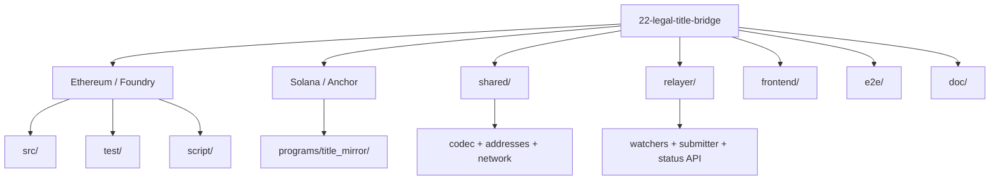
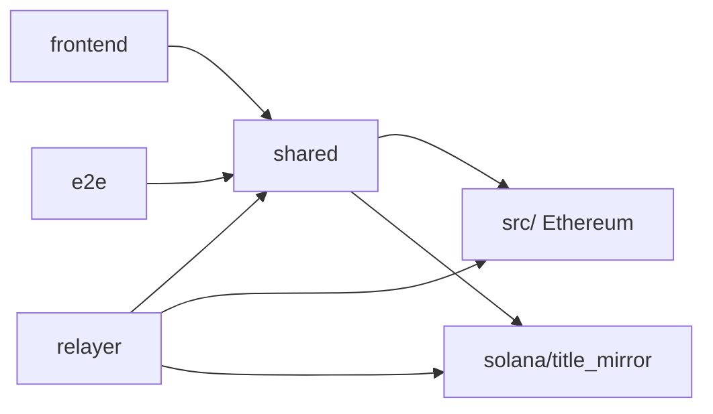
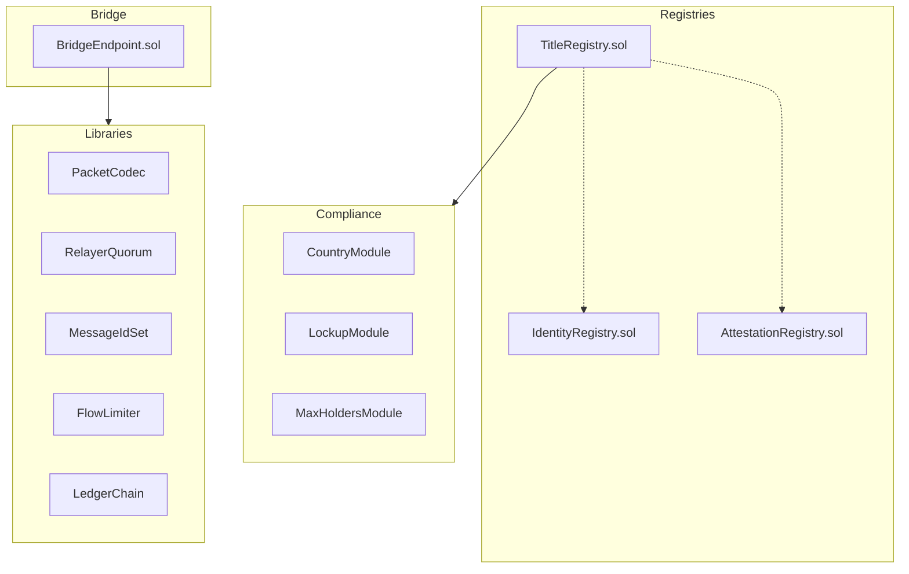
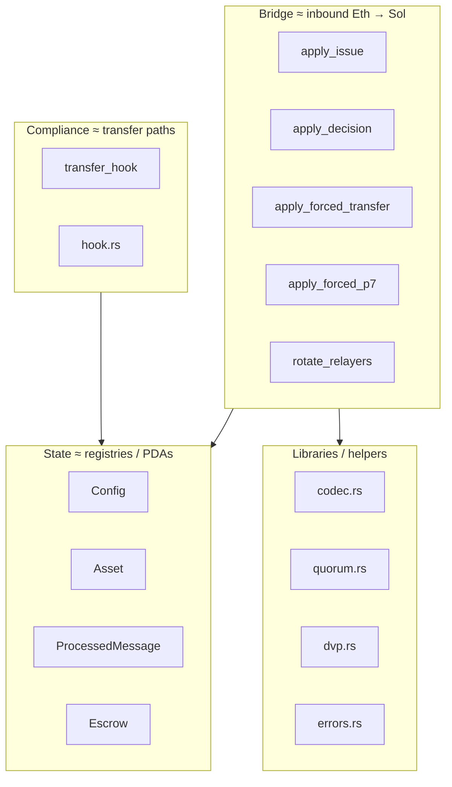
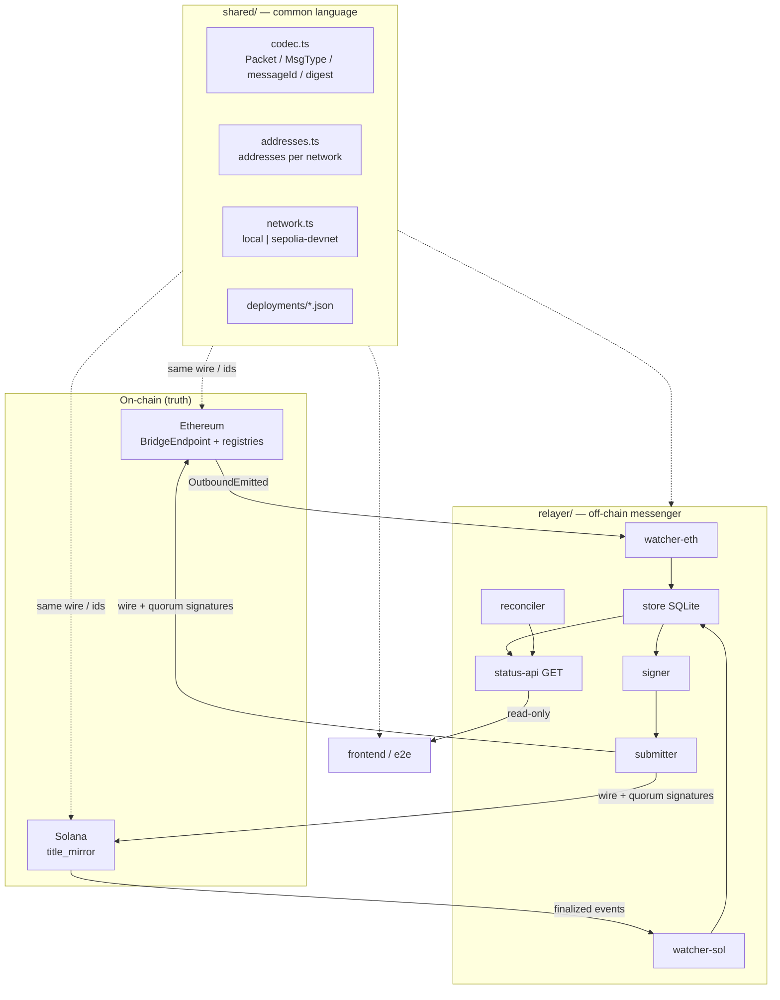
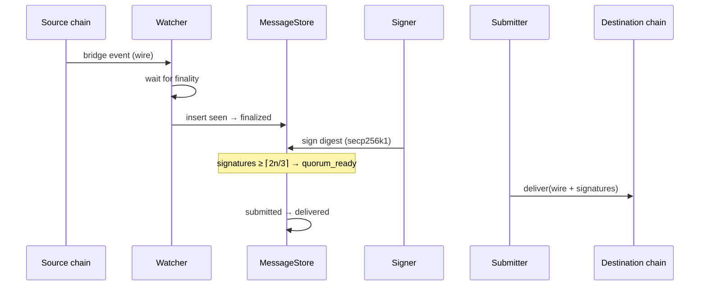
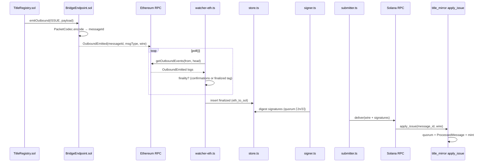
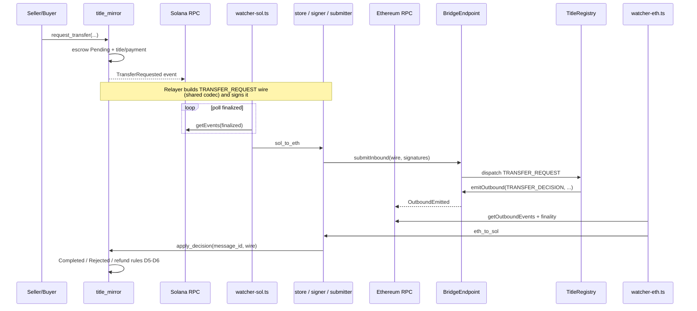
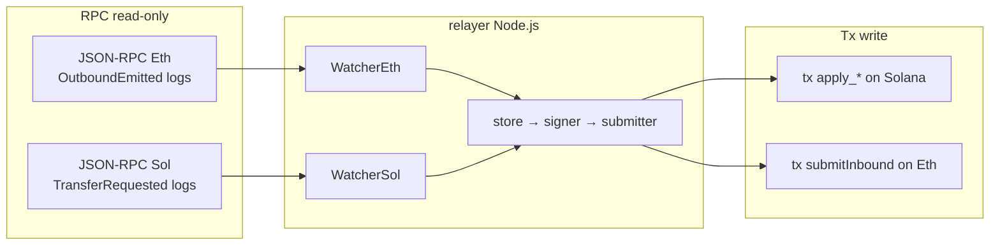

# How it works — Legal Title Bridge

> 🌐 **English** · [Español](./detalles-de-funcionamiento-ES.md)

**Language:** English · Orientation doc on structure and flows.  
**Scope:** Sepolia + Solana Devnet lab (not production).  
**Governance rule:** Ethereum commands; the frontend is not truth (D14); codec aligned in three languages (C5).

---

## 1. Monorepo overview

Ethereum ↔ Solana bridge for legal titles. Main pieces:

| Folder | Role |
|--------|------|
| `src/` | Solidity contracts (Foundry): registries, bridge, compliance, libraries |
| `test/` | Foundry tests (unit, invariant, mocks, redteam, extatk) |
| `solana/` | Anchor program `title_mirror` + Devnet tests/scripts |
| `shared/` | Protocol kit: codec, networks, addresses (Zod) |
| `relayer/` | Off-chain messenger (Node.js): watchers, signing, delivery, GET API |
| `frontend/` | Next.js 16: assets, bridge, wallet, operator, verifier |
| `e2e/` | Local Anvil+Solana stack + lifecycle/failure scenarios |
| `doc/` | Documentation (plan, protocols, security, QA) |
| `script/` / `scripts/` | Foundry deploy vs bash/hooks/lint utilities |
| `secrets/` | Lab keys (deploy, relayers, roles) |
| `lib/` | Foundry dependencies (OpenZeppelin, forge-std) |
| `broadcast/` / `out/` / `cache/` | Generated forge artifacts |

### Flow between pieces

`shared/` is the data hub (bytes, networks, addresses). The relayer watches both chains and delivers messages. On-chain validates quorum and changes state.

---

## 2. Ethereum — `src/` by function

### Registries (root of `src/`)

| File | Function |
|------|----------|
| `TitleRegistry.sol` | Asset lifecycle and DvP / transfers on Ethereum |
| `IdentityRegistry.sol` | Holder identity (EIP-712, Solana key as `bytes32`) |
| `AttestationRegistry.sol` | Asset certifications (existence + registry, quorum) |

- Interfaces: `interfaces/IIdentityRegistry.sol`, `IAttestationRegistry.sol`
- Errors: `errors/RegistryErrors.sol`
- `TitleRegistry` has no dedicated interface under `interfaces/`

### Bridge

| File | Function |
|------|----------|
| `BridgeEndpoint.sol` | Quorum inbound (`submitInbound`), typed outbound (`emitOutbound`), pause, relayer rotation |

- Interface: `interfaces/IBridgeEndpoint.sol`
- Errors: `errors/BridgeErrors.sol`
- Key events: `OutboundEmitted(messageId, msgType, wire)`, `InboundProcessed(messageId, msgType)`

### Compliance (`src/compliance/`)

Modules consulted by `TitleRegistry` before approving a transfer (`IComplianceModule`):

| File | Rule |
|------|------|
| `CountryModule.sol` | Buyer country on allowlist |
| `LockupModule.sol` | Temporary holder lockup |
| `MaxHoldersModule.sol` | Cap on holders with balance > 0 |

### Libraries (`src/libraries/`)

| File | Function |
|------|----------|
| `PacketCodec.sol` | Cross-chain packet encode/decode (C5) |
| `RelayerQuorum.sol` | Threshold and ECDSA verification of relayers |
| `MessageIdSet.sol` | Idempotency of inbound `messageId`s |
| `FlowLimiter.sol` | Per-asset / per-transfer flow caps |
| `LedgerChain.sol` | Ledger hash chain |

- Codec errors: `errors/CodecErrors.sol`
- `Smoke.sol` is a toolchain placeholder (BOOT), not product logic

---

## 3. Solana — `title_mirror` by function

On Solana there is not a set of separate programs: everything lives in **`title_mirror`**. Identity/Attestation stay on Ethereum.

### State ≈ registries (`state/mod.rs`)

| PDA account | Role (Eth analogue) |
|-------------|---------------------|
| `Config` | Remote endpoint + relayers + pause + deadlines |
| `Asset` | Per-`assetId` mirror + Token-2022 mint |
| `ProcessedMessage` | `messageId` idempotency |
| `Escrow` | DvP Pending → Completed / Refunded / CourtCancelled |

Seeds: `config`, `asset`, `processed`, `escrow`, `permanent_delegate`, `escrow_authority`, `extra-account-metas`.

### Bridge (`instructions/` + `quorum.rs`)

| Instruction | Function |
|-------------|----------|
| `initialize_config` / `rotate_relayers` | Relayer set bootstrap and rotation |
| `apply_issue` | Applies ISSUE from Eth (mirror mint) |
| `apply_decision` | Applies DvP decision |
| `apply_forced_transfer` | Forced transfer |
| `apply_forced_p7` | Forced with Pending escrow (court cut) |
| `request_transfer` / `refund_after_hard_deadline` | Local DvP + unilateral refund (D5) |

Relevant Solana event for Sol→Eth: `TransferRequested` in `request_transfer`.

### Compliance (`hook.rs` + `transfer_hook`)

No Country/Lockup/MaxHolders. The rule is **I5**: only the escrow or the permanent delegate may move the title.

| Piece | Function |
|-------|----------|
| `hook.rs` | Classifies authority (`TransferPath`) |
| `transfer_hook` | Token-2022 entry; rejects unauthorized paths |
| feature `redteam` | Intentionally vulnerable variant |

### Libraries

| Module | Eth analogue | Function |
|--------|--------------|----------|
| `codec.rs` | `PacketCodec.sol` | LTB wire (must match Eth + `shared/`) |
| `quorum.rs` | `RelayerQuorum.sol` | ⌈2n/3⌉ + secp256k1 via Instructions sysvar |
| `dvp.rs` | deadline helpers | Unilateral refund / reject post–hard deadline |
| `errors.rs` | `*Errors.sol` | `MirrorError` |

### Eth ↔ Sol parallel

| Function | Ethereum (`src/`) | Solana (`title_mirror`) |
|----------|-------------------|-------------------------|
| Registries | `Title` / `Identity` / `Attestation` | PDAs `Asset` + `Escrow` (identity/attest only on Eth) |
| Bridge | `BridgeEndpoint` | `apply_*` + `Config` + `quorum` |
| Compliance | `compliance/*` | `hook` / `transfer_hook` |
| Libraries | `libraries/*` | `codec` / `quorum` / `dvp` |

---

## 4. Shared and Relayer — the off-chain bridge

**Nuance:** `shared/` is not the runtime bridge; it is the **protocol kit**. The **messenger** is `relayer/` (Node.js). On-chain endpoints remain `BridgeEndpoint` + `title_mirror`.

### `shared/` — contents

| Piece | Contains | Purpose |
|-------|----------|---------|
| `codec.ts` | `MsgType`, encode/decode, `messageId`, `signingDigest` | Same bytes as `PacketCodec.sol` and `codec.rs` |
| `addresses.ts` | Zod + Eth/Sol addresses per network | D14: nobody takes addresses from the URL |
| `network.ts` | `'local' \| 'sepolia-devnet'` | Environment identifier |
| `deployments/` | Post-deploy JSON | Source of real addresses |
| `index.ts` | Re-exports | Single import surface |

It does not watch chains or sign. It only defines the data contract.

### `relayer/` — message pipeline

| Module | Role |
|--------|------|
| `watcher-eth.ts` | Reads Eth outbound; finality by confirmations or `finalized` tag |
| `watcher-sol.ts` | Reads Sol events; `finalized` commitment only |
| `store.ts` | SQLite: unique `messageId`, states, exponential retries |
| `signer.ts` | Signs the `signingDigest` (no EIP-191 prefix) |
| `submitter.ts` | Collects signatures; with quorum delivers to destination |
| `reconciler.ts` | I2 (Eth=Sol supply) and D6 (Approved vs Refunded) |
| `status-api.ts` | HTTP GET `/status` and `/messages` |
| `types.ts` | Directions `eth_to_sol` / `sol_to_eth` and states |

Message states: `seen → finalized → signed → quorum_ready → submitted → delivered` (or `failed`).

### Message types (`MsgType`, D8)

| MsgType | Direction | Typical origin | Destination applies |
|--------:|-----------|----------------|---------------------|
| `ISSUE` (0) | Eth → Sol | Ethereum | `apply_issue` |
| `TRANSFER_REQUEST` (1) | Sol → Eth | Solana (DvP) | `BridgeEndpoint.submitInbound` |
| `TRANSFER_DECISION` (2) | Eth → Sol | Ethereum | `apply_decision` |
| `FORCED_TRANSFER` (3) | Eth → Sol | Ethereum | `apply_forced_*` |

In one line:

- **`shared/`** = bridge dictionary (bytes, networks, addresses).
- **`relayer/`** = courier that sees a finalized event, stores it, signs in quorum, and delivers.
- **On-chain** = who validates quorum and changes state; the relayer is not an authority.

---

## 5. ISSUE map (Eth → Sol)

Key files: `TitleRegistry` → `BridgeEndpoint.emitOutbound` → `watcher-eth` → `store` / `signer` / `submitter` → `apply_issue`.

---

## 6. DvP map (REQUEST Sol→Eth, then DECISION Eth→Sol)

---

## 7. How the Node relayer “receives” events

The process does **not** get push from the chain. It **polls** RPCs: reads logs/events, waits for finality, signs, and **pushes** a tx to the other chain.

### Eth → Sol (detail)

1. On Eth, `TitleRegistry` (or another role) calls `BridgeEndpoint.emitOutbound` → log **`OutboundEmitted(messageId, msgType, wire)`**.
2. `WatcherEth.poll()` uses an `EthBlockSource` adapter:
   - `getBlockNumber` / `getFinalizedBlockNumber`
   - `getOutboundEvents(from, to)` → in practice `eth_getLogs` of `bridgeEndpoint` from `shared/addresses`
3. Only if the block is final (`confirmations` or `finalized` tag) → `MessageStore`
4. Relayers sign the `signingDigest` (same codec in three languages)
5. With quorum, `Submitter` sends a Solana tx: `apply_issue` / `apply_decision` / `apply_forced_*`
6. On-chain Solana re-validates quorum (secp256k1 + Instructions sysvar) and applies the effect

**Model:** Eth RPC (read) → Node → Sol RPC (write).

### Sol → Eth (detail)

1. `request_transfer` emits **`TransferRequested`**; the `TRANSFER_REQUEST` wire is built with the canonical codec
2. `WatcherSol.poll()` requires **`finalized`** commitment via `SolEventSource.getEvents`
3. Dedup by `messageId` → store with direction `sol_to_eth`
4. Sign + quorum
5. Deliver on Eth: **`BridgeEndpoint.submitInbound(wire, signatures)`** (permissionless; valid quorum matters)
6. Eth marks `messageId` processed and dispatches to the registry

**Model:** Sol RPC (read) → Node → Eth RPC (write).

### Adapter design

Watchers do **not** embed a concrete RPC client; they receive injectable interfaces:

- `EthBlockSource` / `SolEventSource` (read)
- `DeliveryTransport` (write)

Tests/e2e inject fakes (`e2e/src/sim/relayer-fleet.ts`). On testnet the real adapter talks to Sepolia / Devnet.

---

## 8. Related references

- Message protocol (wire, digests): [`PROTOCOLO-ES.md`](./PROTOCOLO-ES.md)
- Planning and decisions D1–D14: [`planificacion-EN.md`](./planificacion-EN.md)
- Milestones: [`hitos-ES.md`](./hitos-ES.md)
- Testnet deploy: [`DEPLOY-TESTNET-ES.md`](./DEPLOY-TESTNET-ES.md)
- Repo README: [`../README-EN.md`](../README-EN.md)
