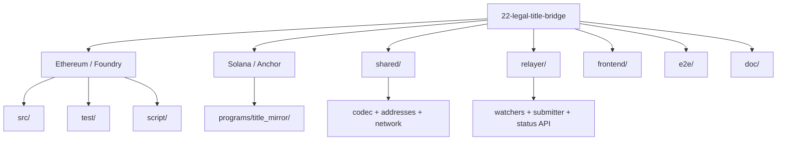
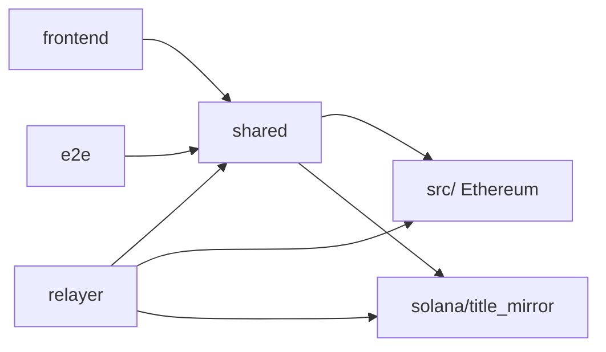
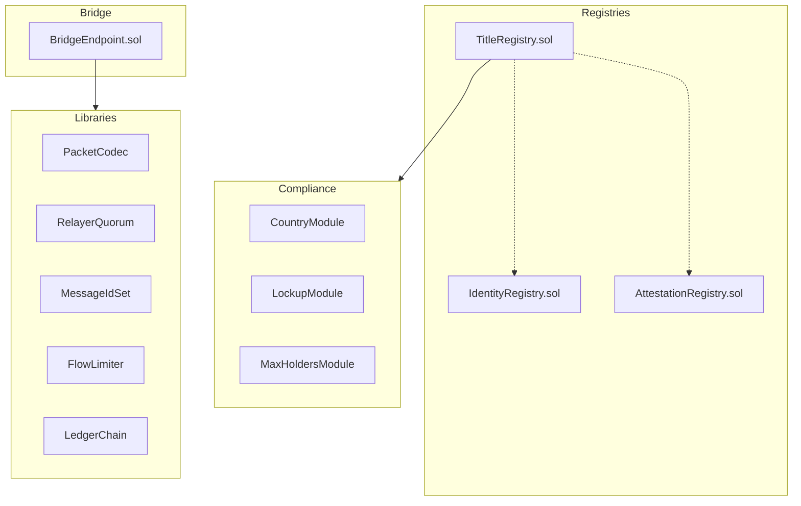
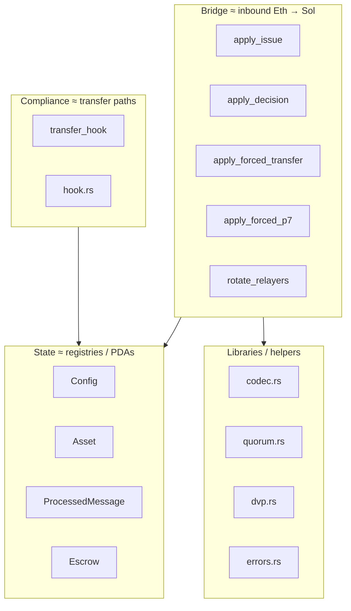
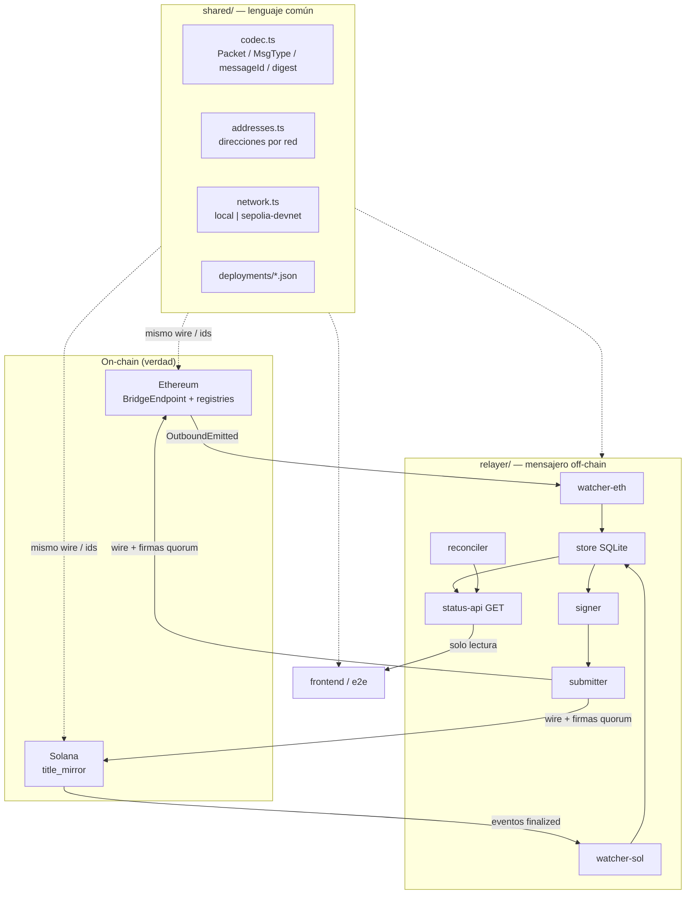
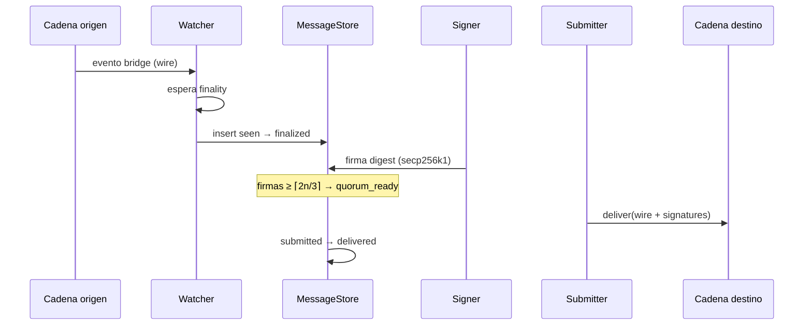
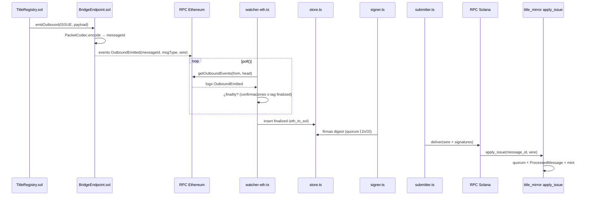
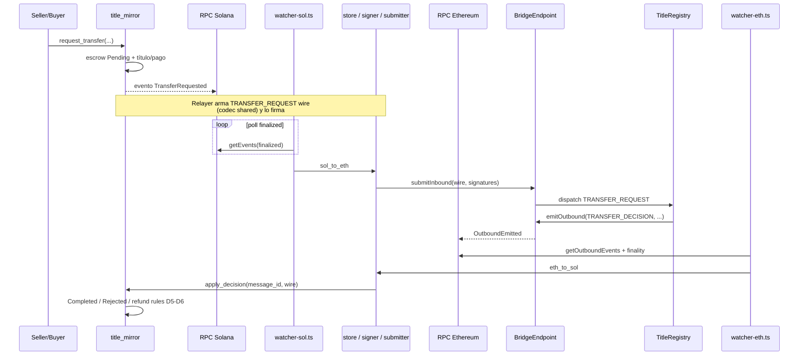
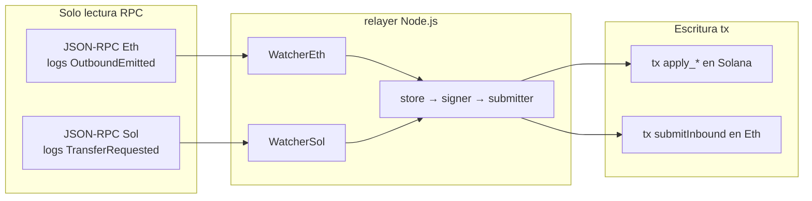

# Detalles de funcionamiento — Legal Title Bridge

> 🌐 **Español** · [English](./detalles-de-funcionamiento-EN.md)

**Idioma:** Español · Documento de orientación sobre estructura y flujos.  
**Alcance:** laboratorio Sepolia + Solana Devnet (no producción).  
**Regla de gobernanza:** Ethereum manda; el frontend no es verdad (D14); códec alineado en tres lenguajes (C5).

---

## 1. Visión general del monorepo

Puente Ethereum ↔ Solana para títulos legales. Las piezas principales:

| Carpeta | Rol |
|---------|-----|
| `src/` | Contratos Solidity (Foundry): registries, bridge, compliance, libraries |
| `test/` | Tests Foundry (unit, invariant, mocks, redteam, extatk) |
| `solana/` | Programa Anchor `title_mirror` + tests/scripts Devnet |
| `shared/` | Kit de protocolo: códec, redes, direcciones (Zod) |
| `relayer/` | Mensajero off-chain (Node.js): watchers, firma, entrega, API GET |
| `frontend/` | Next.js 16: activos, puente, cartera, operador, verificador |
| `e2e/` | Stack local Anvil+Solana + escenarios lifecycle/failures |
| `doc/` | Documentación en español (plan, protocolos, seguridad, QA) |
| `script/` / `scripts/` | Deploy Foundry vs utilidades bash/hooks/lint |
| `secrets/` | Keys de laboratorio (deploy, relayers, roles) |
| `lib/` | Dependencias Foundry (OpenZeppelin, forge-std) |
| `broadcast/` / `out/` / `cache/` | Artefactos generados de forge |

### Flujo entre piezas

`shared/` es el hub de datos (bytes, redes, direcciones). El relayer observa ambas cadenas y entrega mensajes. On-chain valida quorum y cambia estado.

---

## 2. Ethereum — `src/` por función

### Registries (raíz de `src/`)

| Archivo | Función |
|---------|---------|
| `TitleRegistry.sol` | Ciclo de vida del activo y DvP / transferencias en Ethereum |
| `IdentityRegistry.sol` | Identidad del holder (EIP-712, clave Solana como `bytes32`) |
| `AttestationRegistry.sol` | Certificaciones del activo (existencia + registral, quorum) |

- Interfaces: `interfaces/IIdentityRegistry.sol`, `IAttestationRegistry.sol`
- Errores: `errors/RegistryErrors.sol`
- `TitleRegistry` no tiene interfaz propia en `interfaces/`

### Bridge

| Archivo | Función |
|---------|---------|
| `BridgeEndpoint.sol` | Entrada con quorum (`submitInbound`), salida tipada (`emitOutbound`), pause, rotación de relayers |

- Interfaz: `interfaces/IBridgeEndpoint.sol`
- Errores: `errors/BridgeErrors.sol`
- Eventos clave: `OutboundEmitted(messageId, msgType, wire)`, `InboundProcessed(messageId, msgType)`

### Compliance (`src/compliance/`)

Módulos consultados por `TitleRegistry` antes de aprobar un transfer (`IComplianceModule`):

| Archivo | Regla |
|---------|--------|
| `CountryModule.sol` | País del comprador en allowlist |
| `LockupModule.sol` | Bloqueo temporal del holder |
| `MaxHoldersModule.sol` | Tope de holders con balance > 0 |

### Libraries (`src/libraries/`)

| Archivo | Función |
|---------|---------|
| `PacketCodec.sol` | Encode/decode del paquete cross-chain (C5) |
| `RelayerQuorum.sol` | Umbral y verificación ECDSA de relayers |
| `MessageIdSet.sol` | Idempotencia de `messageId` entrantes |
| `FlowLimiter.sol` | Caps de flujo por activo / transferencia |
| `LedgerChain.sol` | Cadena de hashes del ledger |

- Errores del códec: `errors/CodecErrors.sol`
- `Smoke.sol` es placeholder de toolchain (BOOT), no lógica de producto

---

## 3. Solana — `title_mirror` por función

En Solana no hay varios programas: todo vive en **`title_mirror`**. Identity/Attestation quedan en Ethereum.

### State ≈ registries (`state/mod.rs`)

| Cuenta PDA | Rol (análogo Eth) |
|------------|-------------------|
| `Config` | Endpoint remoto + relayers + pause + plazos |
| `Asset` | Espejo por `assetId` + mint Token-2022 |
| `ProcessedMessage` | Idempotencia de `messageId` |
| `Escrow` | DvP Pending → Completed / Refunded / CourtCancelled |

Seeds: `config`, `asset`, `processed`, `escrow`, `permanent_delegate`, `escrow_authority`, `extra-account-metas`.

### Bridge (`instructions/` + `quorum.rs`)

| Instrucción | Función |
|-------------|---------|
| `initialize_config` / `rotate_relayers` | Alta y rotación de relayers |
| `apply_issue` | Aplica ISSUE desde Eth (mint espejo) |
| `apply_decision` | Aplica decisión DvP |
| `apply_forced_transfer` | Transferencia forzada |
| `apply_forced_p7` | Forzada con escrow Pending (corte) |
| `request_transfer` / `refund_after_hard_deadline` | DvP local + refund unilateral (D5) |

Evento Solana relevante para Sol→Eth: `TransferRequested` en `request_transfer`.

### Compliance (`hook.rs` + `transfer_hook`)

No hay Country/Lockup/MaxHolders. La regla es **I5**: solo mueven el título el escrow o el permanent delegate.

| Pieza | Función |
|-------|---------|
| `hook.rs` | Clasifica autoridad (`TransferPath`) |
| `transfer_hook` | Entry Token-2022; rechaza paths no autorizados |
| feature `redteam` | Variante vulnerable a propósito |

### Libraries

| Módulo | Análogo Eth | Función |
|--------|-------------|---------|
| `codec.rs` | `PacketCodec.sol` | Wire LTB (debe matchear Eth + `shared/`) |
| `quorum.rs` | `RelayerQuorum.sol` | ⌈2n/3⌉ + secp256k1 vía sysvar Instructions |
| `dvp.rs` | helpers de plazos | Refund unilateral / reject post–hard deadline |
| `errors.rs` | `*Errors.sol` | `MirrorError` |

### Paralelo Eth ↔ Sol

| Función | Ethereum (`src/`) | Solana (`title_mirror`) |
|---------|-------------------|-------------------------|
| Registries | `Title` / `Identity` / `Attestation` | PDAs `Asset` + `Escrow` (identidad/attest solo en Eth) |
| Bridge | `BridgeEndpoint` | `apply_*` + `Config` + `quorum` |
| Compliance | `compliance/*` | `hook` / `transfer_hook` |
| Libraries | `libraries/*` | `codec` / `quorum` / `dvp` |

---

## 4. Shared y Relayer — el puente off-chain

**Matiz:** `shared/` no es el puente en runtime; es el **kit de protocolo**. El **mensajero** es `relayer/` (Node.js). Los endpoints on-chain siguen siendo `BridgeEndpoint` + `title_mirror`.

### `shared/` — contenido

| Pieza | Contiene | Para qué |
|-------|----------|----------|
| `codec.ts` | `MsgType`, encode/decode, `messageId`, `signingDigest` | Mismos bytes que `PacketCodec.sol` y `codec.rs` |
| `addresses.ts` | Zod + direcciones Eth/Sol por red | D14: nadie saca direcciones de la URL |
| `network.ts` | `'local' \| 'sepolia-devnet'` | Identificador de entorno |
| `deployments/` | JSON post-deploy | Fuente de direcciones reales |
| `index.ts` | Re-exports | Import único |

No observa cadenas ni firma. Solo define el contrato de datos.

### `relayer/` — pipeline del mensaje

| Módulo | Rol |
|--------|-----|
| `watcher-eth.ts` | Lee outbound Eth; finality por confirmaciones o tag `finalized` |
| `watcher-sol.ts` | Lee eventos Sol; solo commitment `finalized` |
| `store.ts` | SQLite: `messageId` único, estados, retries exponenciales |
| `signer.ts` | Firma el `signingDigest` (sin prefijo EIP-191) |
| `submitter.ts` | Junta firmas; con quorum entrega a destino |
| `reconciler.ts` | I2 (supply Eth=Sol) y D6 (Approved vs Refunded) |
| `status-api.ts` | HTTP GET `/status` y `/messages` |
| `types.ts` | Direcciones `eth_to_sol` / `sol_to_eth` y estados |

Estados del mensaje: `seen → finalized → signed → quorum_ready → submitted → delivered` (o `failed`).

### Tipos de mensaje (`MsgType`, D8)

| MsgType | Dirección | Origen típico | Destino aplica |
|--------:|-----------|---------------|----------------|
| `ISSUE` (0) | Eth → Sol | Ethereum | `apply_issue` |
| `TRANSFER_REQUEST` (1) | Sol → Eth | Solana (DvP) | `BridgeEndpoint.submitInbound` |
| `TRANSFER_DECISION` (2) | Eth → Sol | Ethereum | `apply_decision` |
| `FORCED_TRANSFER` (3) | Eth → Sol | Ethereum | `apply_forced_*` |

En una frase:

- **`shared/`** = diccionario del puente (bytes, redes, direcciones).
- **`relayer/`** = cartero que ve un evento finalizado, lo guarda, lo firma en quorum y lo entrega.
- **On-chain** = quien valida quorum y cambia estado; el relayer no es autoridad.

---

## 5. Mapa ISSUE (Eth → Sol)

Archivos clave: `TitleRegistry` → `BridgeEndpoint.emitOutbound` → `watcher-eth` → `store` / `signer` / `submitter` → `apply_issue`.

---

## 6. Mapa DvP (REQUEST Sol→Eth, luego DECISION Eth→Sol)

---

## 7. Cómo el relayer Node “recibe” eventos

El proceso **no recibe push** de la cadena. **Pide** a los RPC (poll): lee logs/eventos, espera finality, firma y **empuja** una tx a la otra cadena.

### Eth → Sol (detalle)

1. En Eth, `TitleRegistry` (u otro con rol) llama `BridgeEndpoint.emitOutbound` → log **`OutboundEmitted(messageId, msgType, wire)`**.
2. `WatcherEth.poll()` usa un adaptador `EthBlockSource`:
   - `getBlockNumber` / `getFinalizedBlockNumber`
   - `getOutboundEvents(from, to)` → en la práctica `eth_getLogs` del `bridgeEndpoint` en `shared/addresses`
3. Solo si el bloque es final (`confirmations` o tag `finalized`) → `MessageStore`
4. Relayers firman el `signingDigest` (mismo códec en tres lenguajes)
5. Con quorum, `Submitter` envía tx en Solana: `apply_issue` / `apply_decision` / `apply_forced_*`
6. On-chain Solana revalida quorum (secp256k1 + sysvar Instructions) y aplica el efecto

**Modelo:** RPC Eth (leer) → Node → RPC Sol (escribir).

### Sol → Eth (detalle)

1. `request_transfer` emite **`TransferRequested`**; el wire `TRANSFER_REQUEST` se construye con el códec canónico
2. `WatcherSol.poll()` exige commitment **`finalized`** vía `SolEventSource.getEvents`
3. Dedup por `messageId` → store con dirección `sol_to_eth`
4. Firma + quorum
5. Entrega en Eth: **`BridgeEndpoint.submitInbound(wire, signatures)`** (permissionless; importa el quorum válido)
6. Eth marca `messageId` procesado y despacha al registry

**Modelo:** RPC Sol (leer) → Node → RPC Eth (escribir).

### Diseño de adaptadores

Los watchers **no embeben** un cliente RPC concreto; reciben interfaces inyectables:

- `EthBlockSource` / `SolEventSource` (lectura)
- `DeliveryTransport` (escritura)

En tests/e2e se inyectan fakes (`e2e/src/sim/relayer-fleet.ts`). En testnet el adaptador real habla con Sepolia / Devnet.

---

## 8. Referencias relacionadas

- Protocolo de mensajes (wire, digests): [`PROTOCOLO-ES.md`](./PROTOCOLO-ES.md)
- Planificación y decisiones D1–D14: [`planificacion-ES.md`](./planificacion-ES.md)
- Hitos: [`hitos-ES.md`](./hitos-ES.md)
- Deploy testnet: [`DEPLOY-TESTNET-ES.md`](./DEPLOY-TESTNET-ES.md)
- README del repo: [`../README-ES.md`](../README-ES.md)
