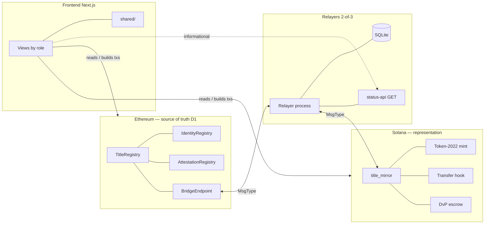
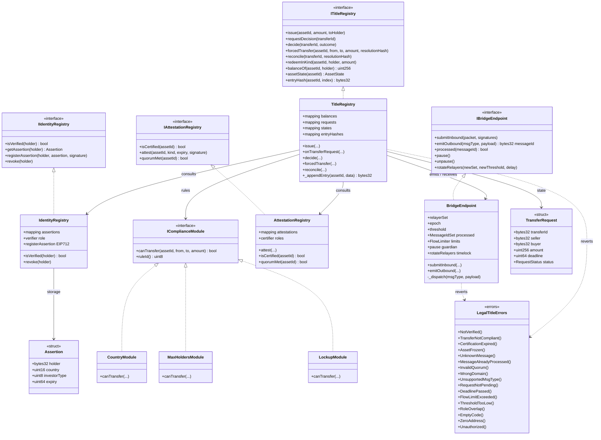
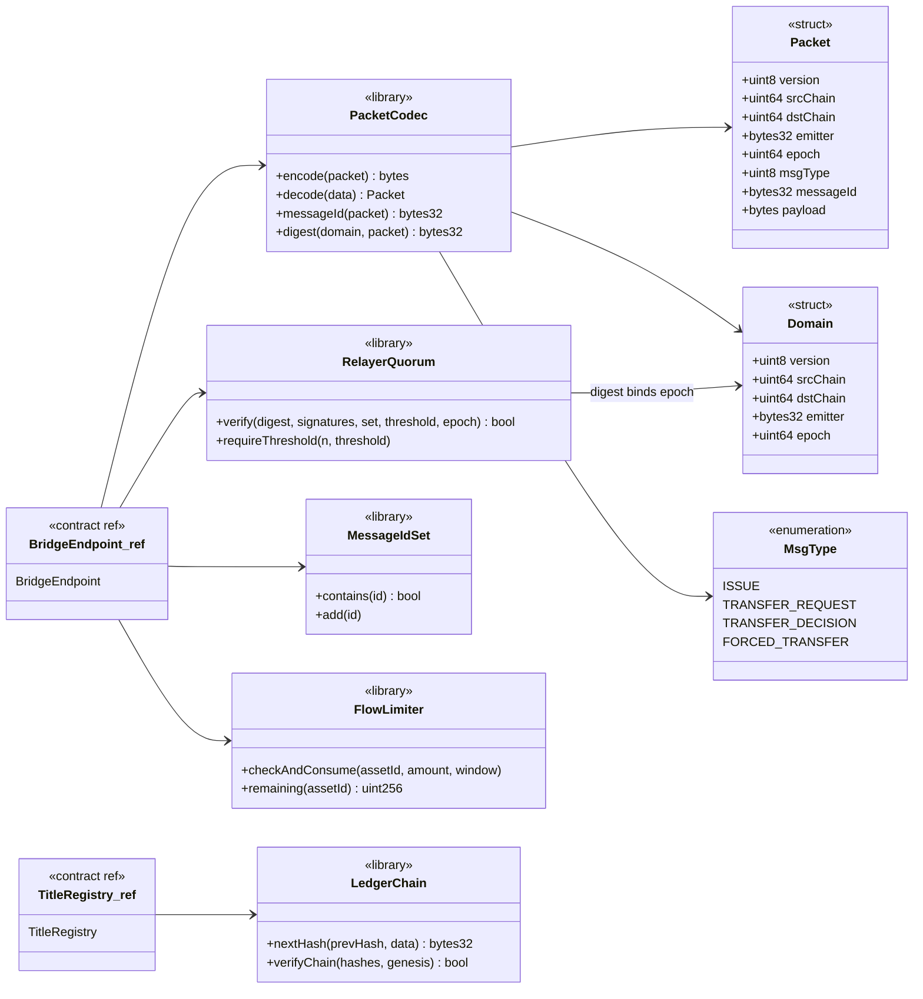
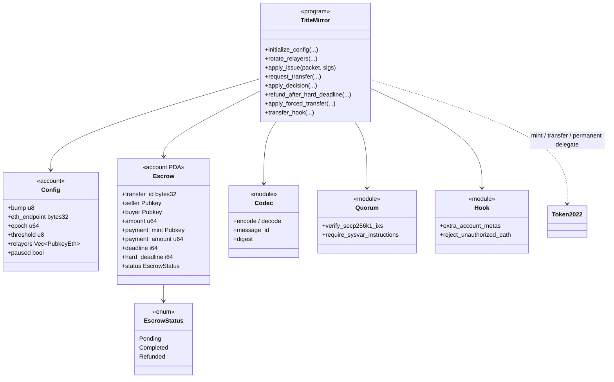
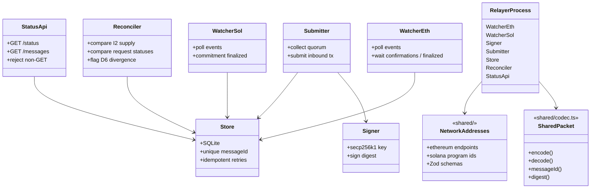
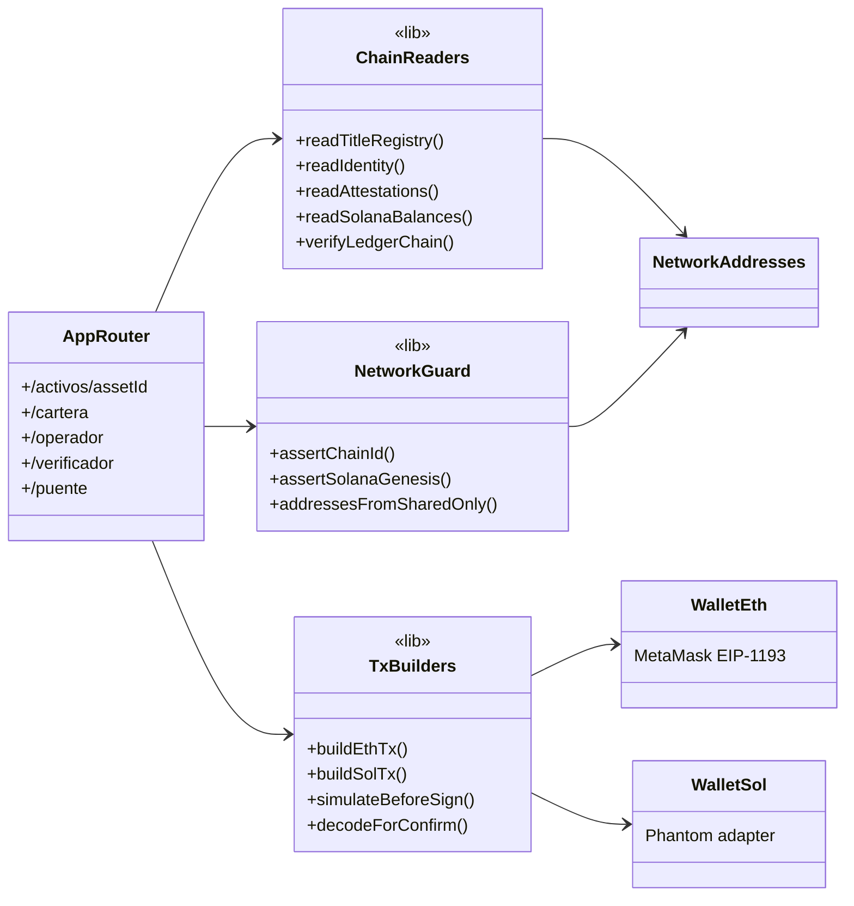

# Class diagram — Legal Title Bridge (Ethereum ↔ Solana)

> 🌐 **English** · [Español](./diagrama-de-clases-ES.md)

**Language:** English · Module 22 · **as-built** (SOLV 2026-11-23).  
**Stack:** Solidity `0.8.37` / EVM Cancun · Anchor `0.31.1` · Relayer + Frontend TypeScript.  
**Source:** [`planificacion-EN.md`](./planificacion-EN.md) §3–§8, D1–D14.

Structural view of Ethereum contracts, Solana program, libraries, typed messages, relayer, and frontend. Method names are the v1 design; responsibilities are stable after TITLE/ENDPOINT/MIRROR/DVP.

---

## 1. Overview (components)

---

## 2. Ethereum — main classes

---

## 3. Ethereum libraries

---

## 4. Solana — `title_mirror` program

**Critical accounts to validate (Cashio/Wormhole lessons):** `Config` (seeds/owner), canonical mint, token accounts (`token::mint`, `token::authority`), escrow PDA, Instructions sysvar with `address = sysvar::instructions::ID`.

---

## 5. Relayer and shared package

---

## 6. Frontend (views and D14 limits)

---

## 7. Roles and who touches what (D13)

| Role | Ethereum | Solana | Frontend |
|------|----------|--------|----------|
| Issuer | `issue` (if certifications OK) | receives mint via `ISSUE` | `/operador` |
| Verifier | EIP-712 identity signatures | — | `/verificador` |
| Certifier | certification signatures | — | `/verificador` |
| Registry operator | states, rules | — | `/operador` |
| Court executor | `forcedTransfer` + hash | effect via `FORCED_TRANSFER` | `/operador` |
| Guardian | `pause` / limits | local pause if applicable | `/operador` |
| Holder / buyer | prior identity | DvP escrow | `/cartera` |
| Relayer | signs inbound/outbound | signs inbound/outbound | read-only on `/puente` |
| Public | read | read | `/activos`, `/puente` |

Deploy checks **`RoleOverlap`**: critical role keys do not overlap.

---

## 8. Relations to invariants

| Class / module | Invariants it upholds |
|----------------|-----------------------|
| `TitleRegistry` + `LedgerChain` | I1, I9 |
| `BridgeEndpoint` + `MessageIdSet` + `RelayerQuorum` | I3, I8 |
| `IdentityRegistry` + `AttestationRegistry` + compliance | I7 |
| `Escrow` + decisions | I4, I6 |
| `Hook` + permanent delegate | I5 |
| `Reconciler` | I2 (and D6 detection) |

---

## 9. Reading notes

- This diagram is **as-built** as of SOLV close (2026-11-23); files exist under `src/`, `solana/`, `relayer/`, `frontend/`.
- The codec must be **identical** in Solidity, Rust, and TypeScript (CODEC / C5).
- Governance (relayers, threshold, roles, code) **never** travels in a `MsgType` (D7/D8).
- Update this doc if API names change after TITLE, ENDPOINT, MIRROR, or DVP stabilizations.
