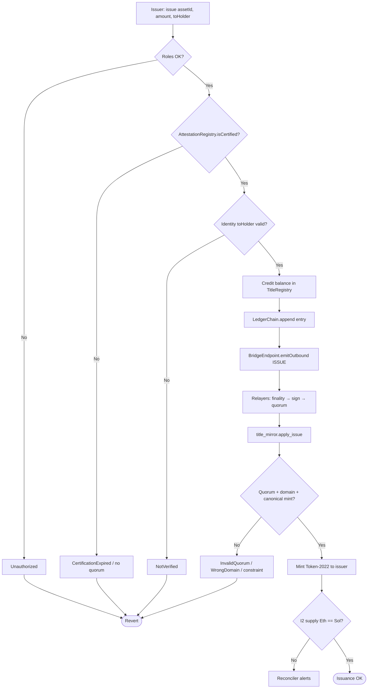
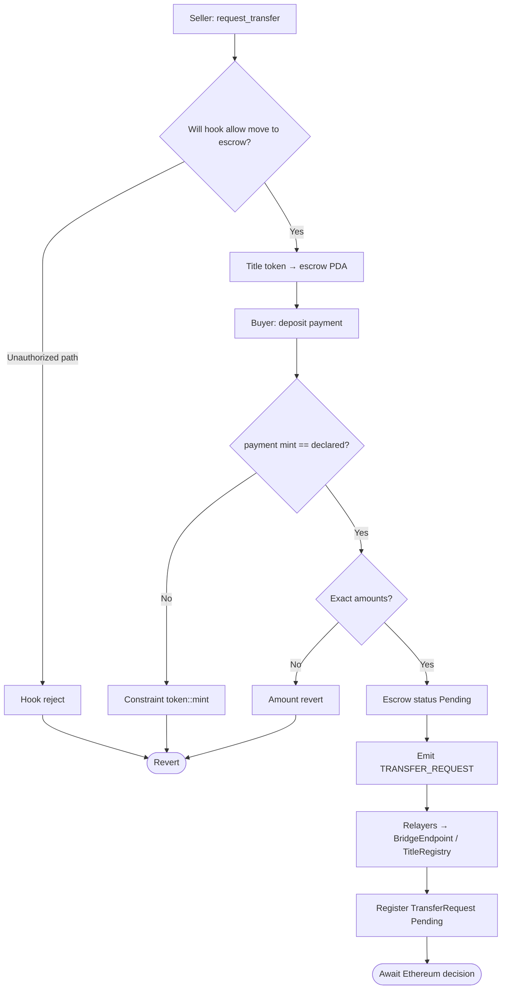
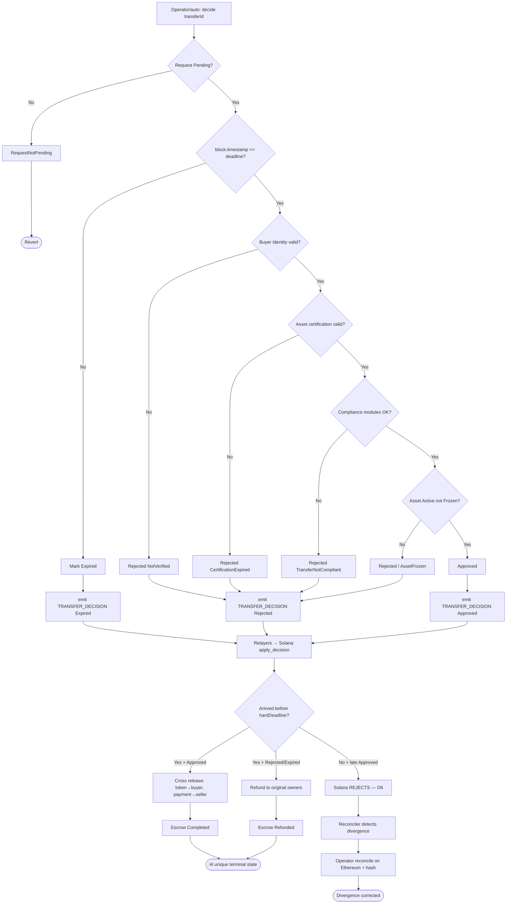
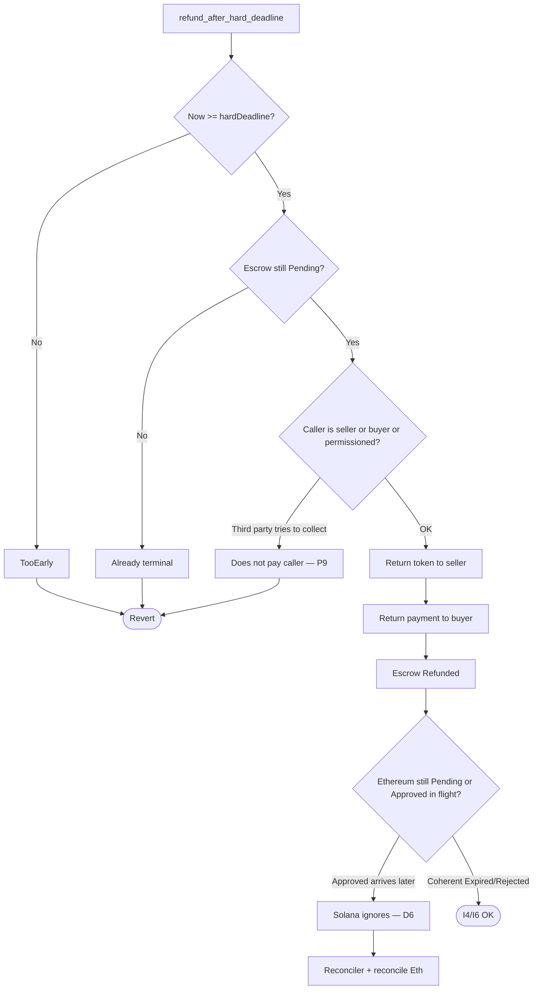
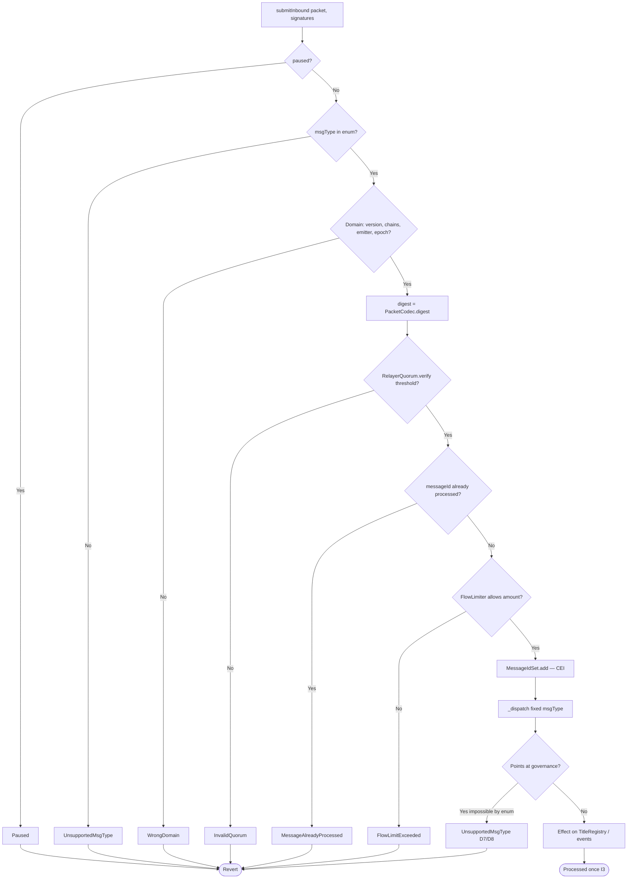
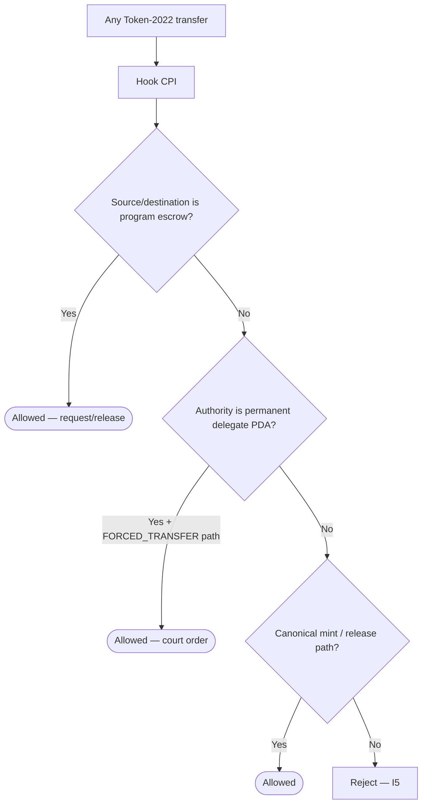
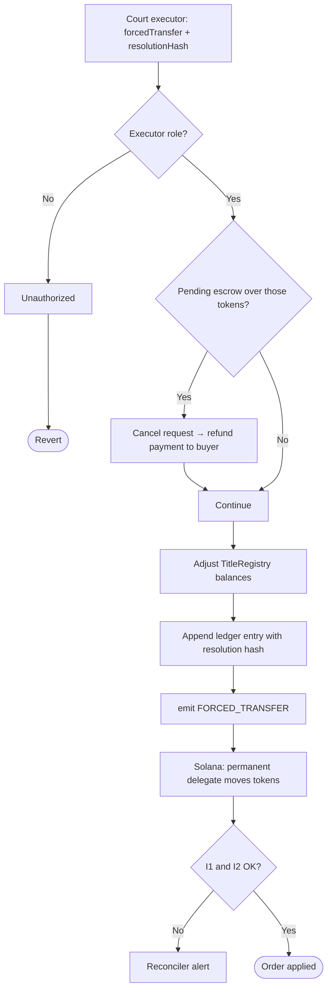
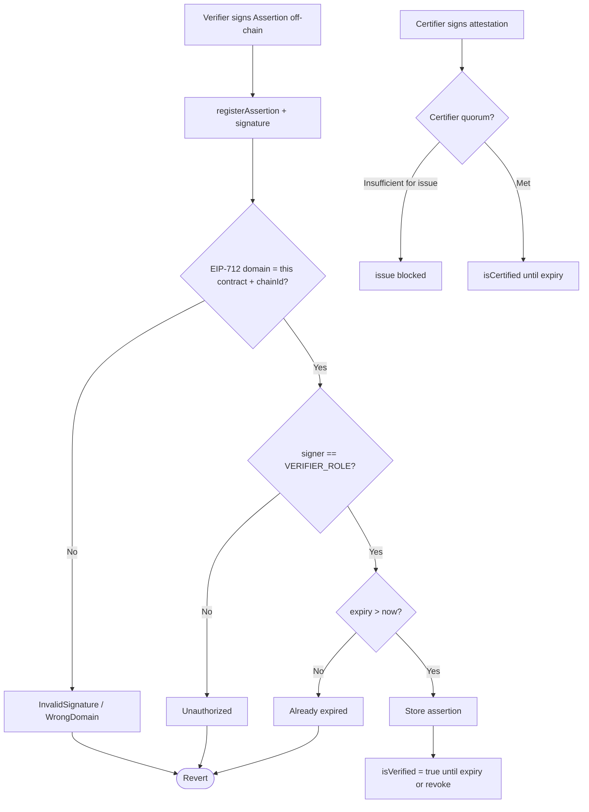
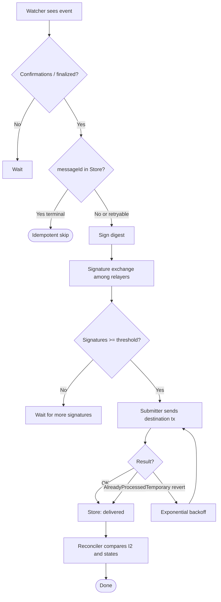
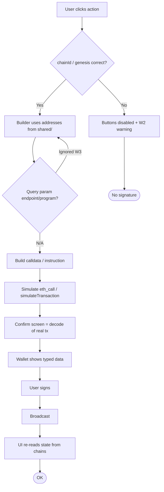

# Flowchart — Legal Title Bridge

> 🌐 **English** · [Español](./diagrama-de-flujo-ES.md)

**Language:** English · Module 22 · **as-built** (SOLV 2026-11-23).  
**Source:** [`planificacion-EN.md`](./planificacion-EN.md) D1–D6, MsgType, §8 invariants.  
**Companion:** [`flujograma-EN.md`](./flujograma-EN.md) (full lifecycle) · [`diagrama-de-clases-EN.md`](./diagrama-de-clases-EN.md).

Internal **decision flows** per operation. Each diamond is a point where the system can revert or branch.

---

## 1. Issuance (`ISSUE`) — Ethereum → Solana

---

## 2. Transfer request + escrow (Solana → Ethereum)

---

## 3. Ethereum decision (D4) → Solana effect (D5/D6)

---

## 4. Unilateral refund after `hardDeadline` (D5)

---

## 5. Inbound on `BridgeEndpoint` (quorum + domain + anti-replay)

**Default state (D9 / Nomad):** an unknown `messageId` is **not** “approved”; it only passes after quorum + `add`.

---

## 6. Transfer hook on Solana (I5)

---

## 7. Court order (`FORCED_TRANSFER`)

---

## 8. Identity / certification verification (EIP-712)

---

## 9. Relayer: from event to idempotent delivery

---

## 10. Frontend: builds tx without being source of truth (D14 / W2–W4)

---

## Deadline legend

| Clock | Who watches it | Effect |
|-------|----------------|--------|
| `deadline` | Ethereum when deciding (D4) | `Approved` only if `now <= deadline`; else → `Expired` |
| `hardDeadline = deadline + 7d` | Solana (D5/D6) | Unilateral refund only after; late `Approved` is rejected |

See also the timeline map in [`flujograma-EN.md`](./flujograma-EN.md).
