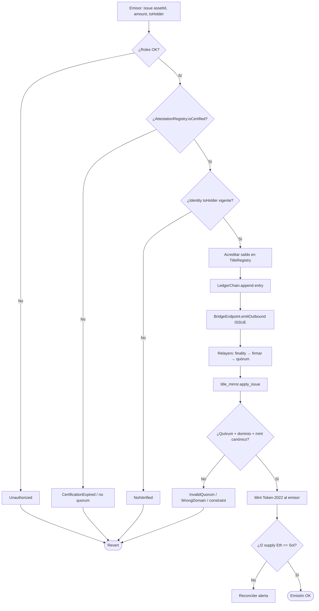
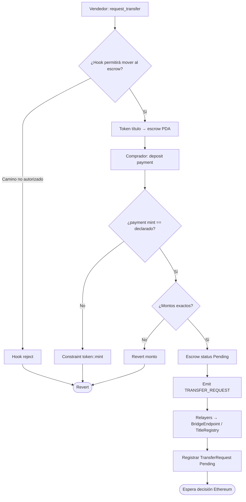
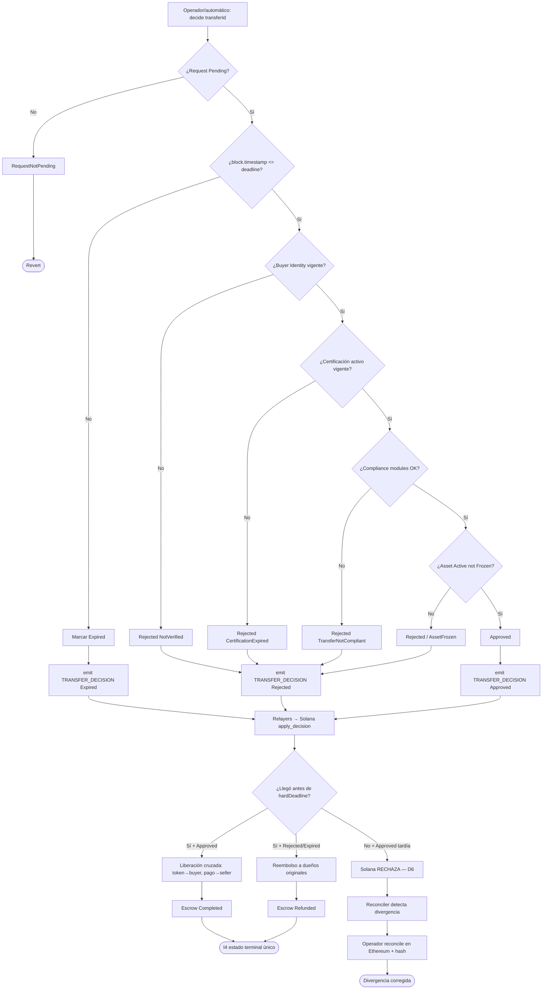
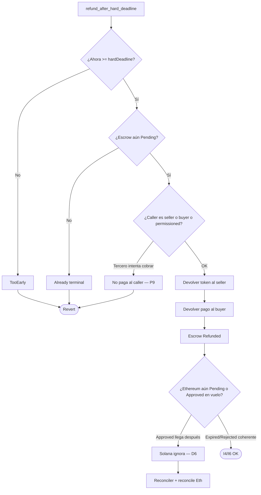
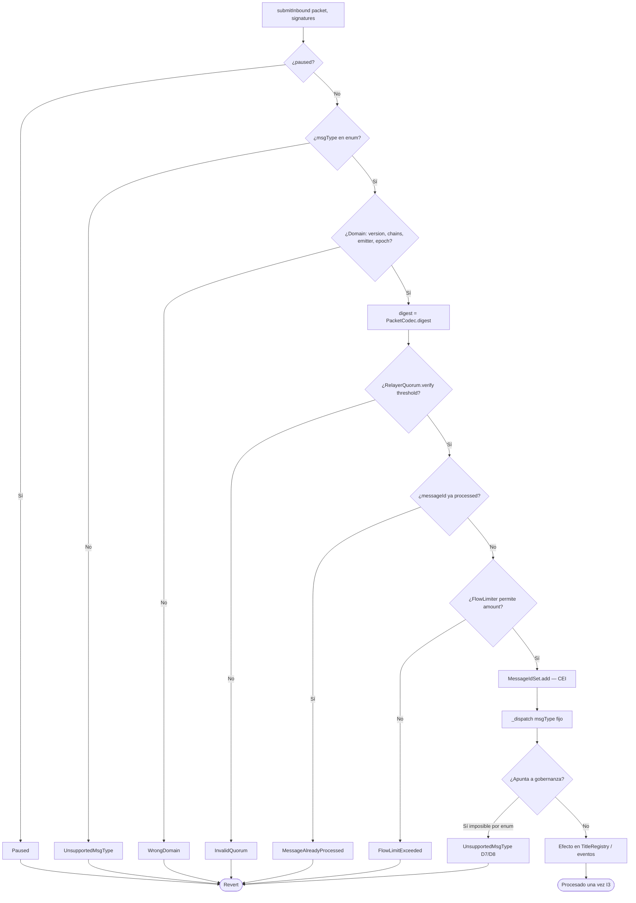
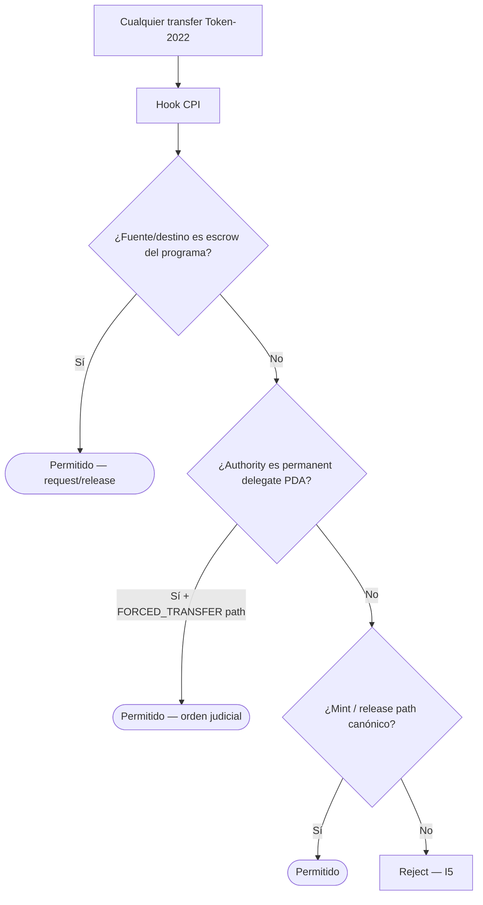
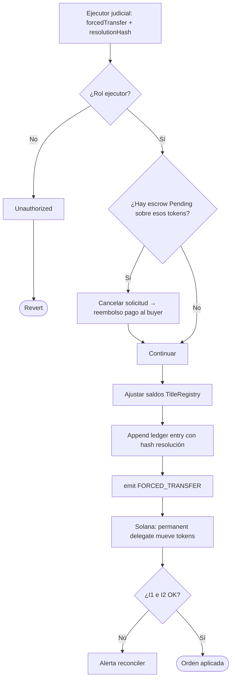
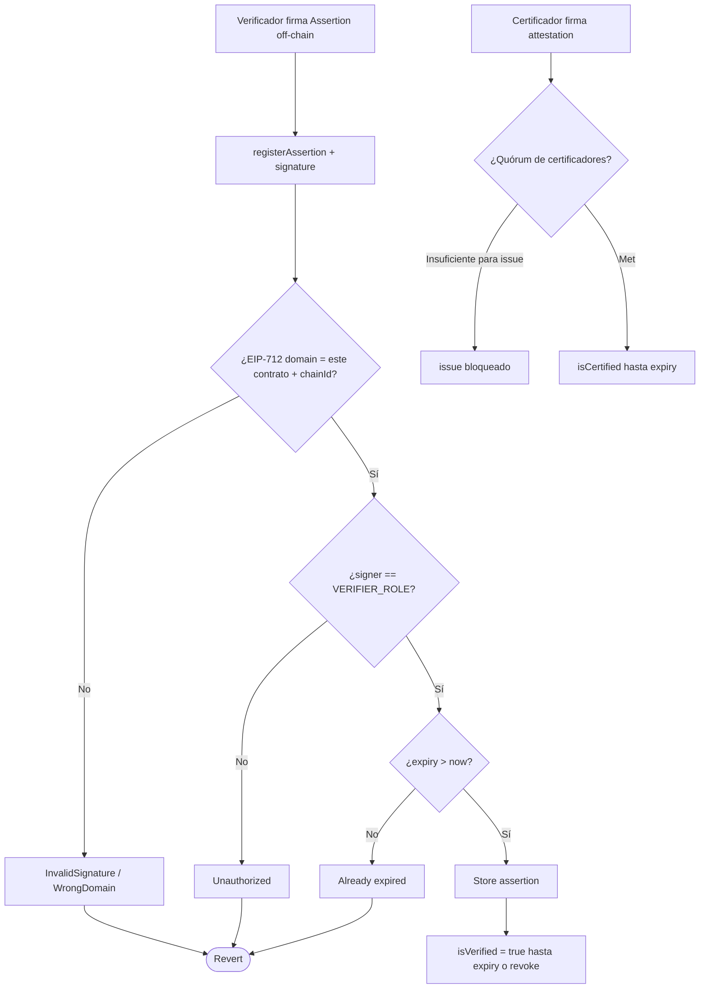
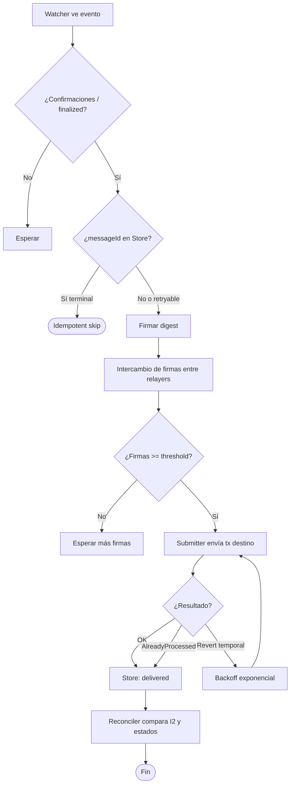
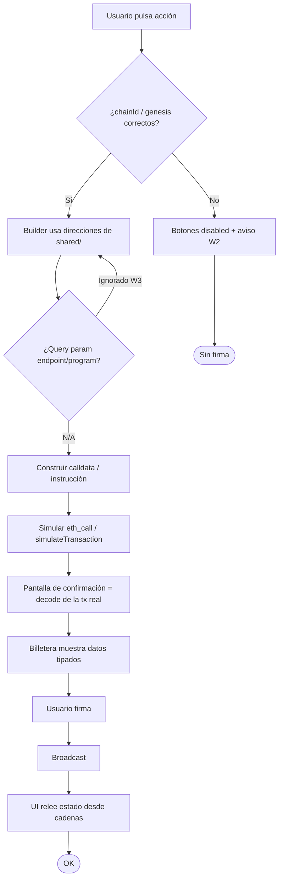

# Diagrama de flujo — Legal Title Bridge

> 🌐 **Español** · [English](./diagrama-de-flujo-EN.md)

**Idioma:** Español · Módulo 22 · **as-built** (SOLV 2026-11-23).  
**Fuente:** [`planificacion-ES.md`](./planificacion-ES.md) D1–D6, MsgType, §8 invariantes.  
**Companion:** [`flujograma-ES.md`](./flujograma-ES.md) (ciclo de vida completo) · [`diagrama-de-clases-ES.md`](./diagrama-de-clases-ES.md).

Flujos de **decisión internos** por operación. Cada rombo es un punto donde el sistema puede revertir o ramificar.

---

## 1. Emisión (`ISSUE`) — Ethereum → Solana

---

## 2. Solicitud de transferencia + escrow (Solana → Ethereum)

---

## 3. Decisión en Ethereum (D4) → efecto en Solana (D5/D6)

---

## 4. Reembolso unilateral tras `hardDeadline` (D5)

---

## 5. Inbound en `BridgeEndpoint` (quórum + dominio + anti-replay)

**Estado por defecto (D9 / Nomad):** un `messageId` desconocido **no** es “aprobado”; solo pasa tras quórum + `add`.

---

## 6. Transfer hook en Solana (I5)

---

## 7. Orden judicial (`FORCED_TRANSFER`)

---

## 8. Verificación de identidad / certificación (EIP-712)

---

## 9. Relayer: de evento a entrega idempotente

---

## 10. Frontend: arma tx sin ser fuente de verdad (D14 / W2–W4)

---

## Leyenda de plazos

| Reloj | Quién lo mira | Efecto |
|-------|---------------|--------|
| `deadline` | Ethereum al decidir (D4) | Solo `Approved` si `now <= deadline`; si no → `Expired` |
| `hardDeadline = deadline + 7d` | Solana (D5/D6) | Reembolso unilateral solo después; `Approved` tardío se rechaza |

Ver también el mapa temporal en [`flujograma-ES.md`](./flujograma-ES.md).
