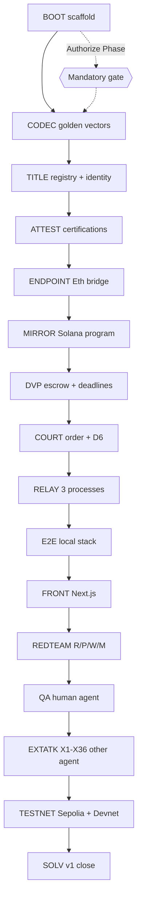
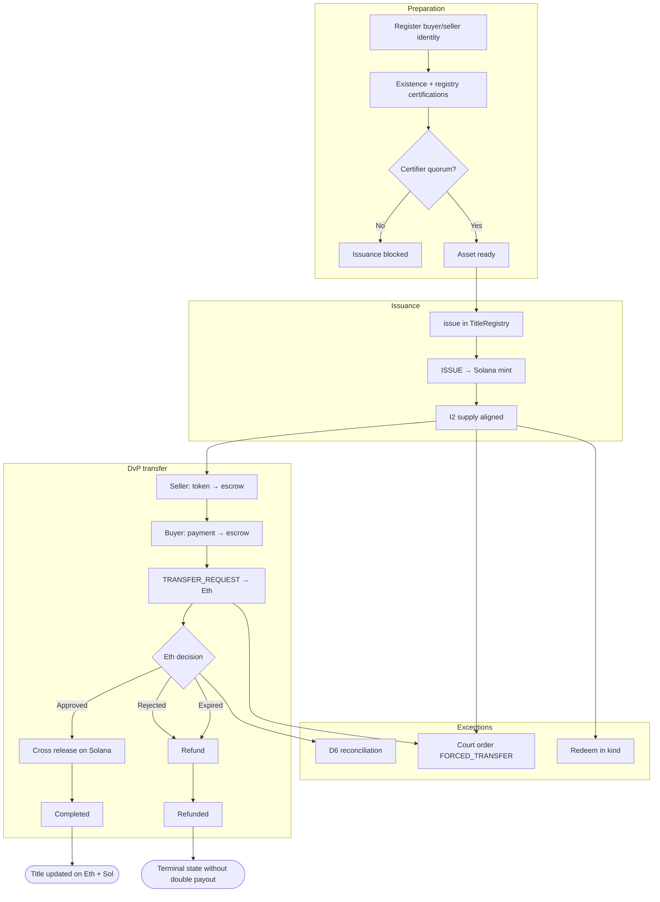
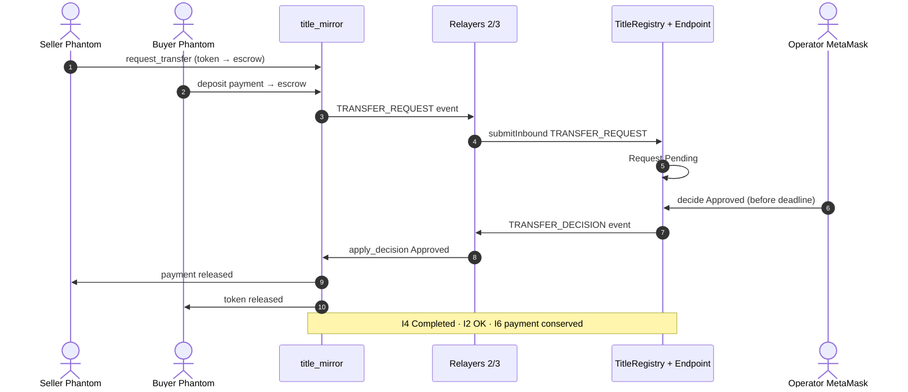
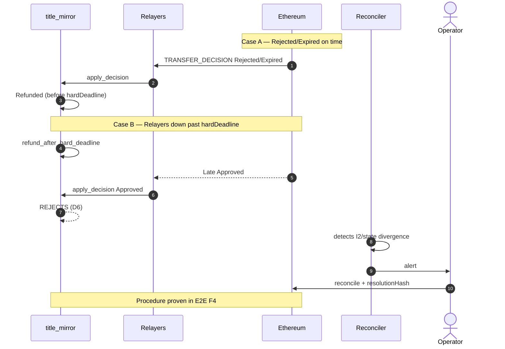
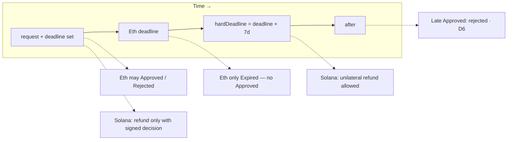
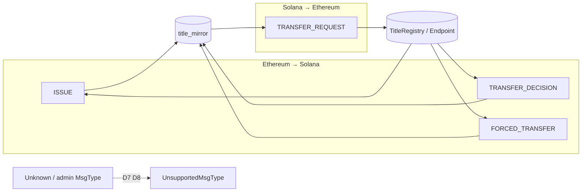
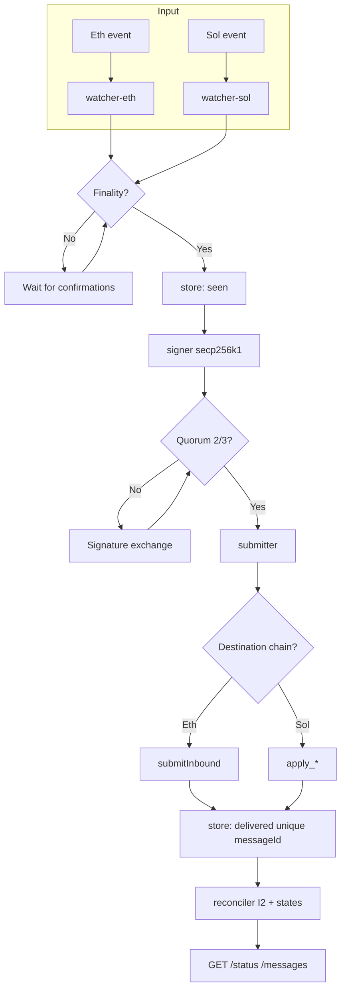
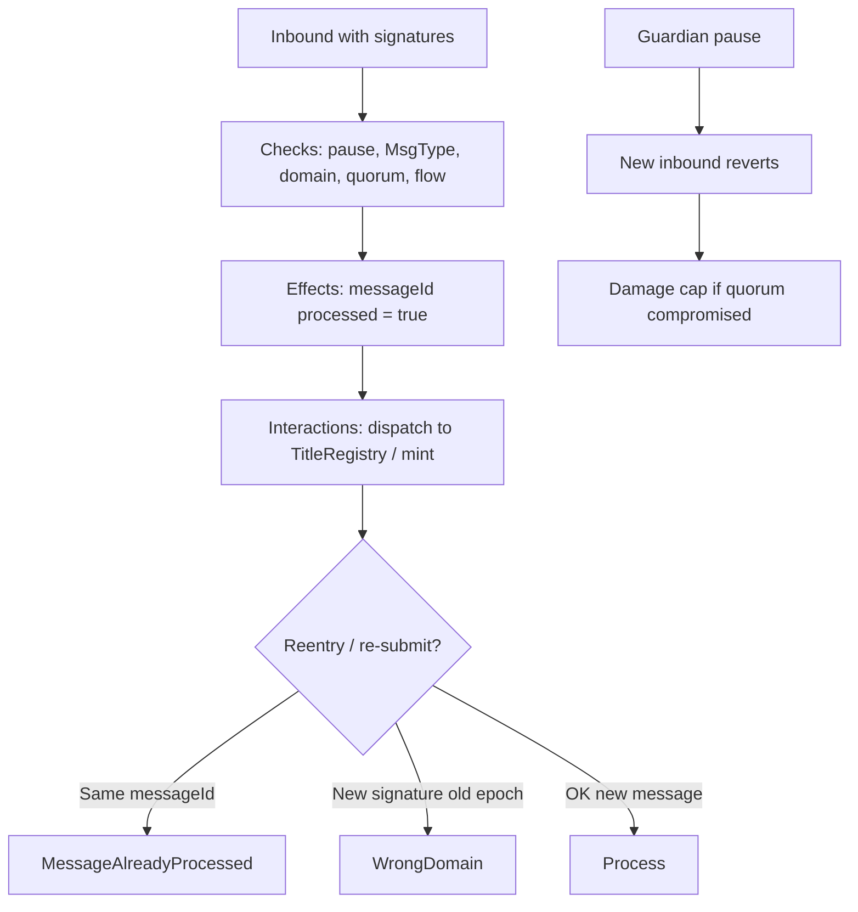
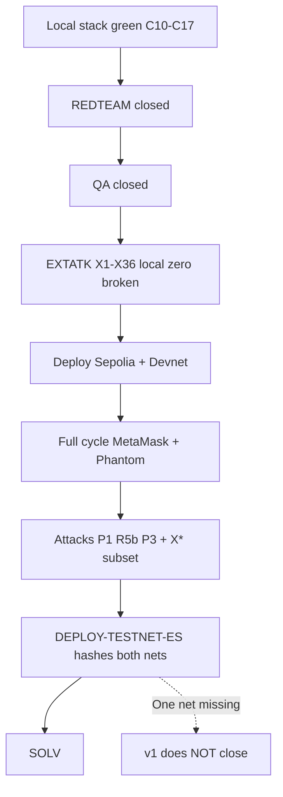
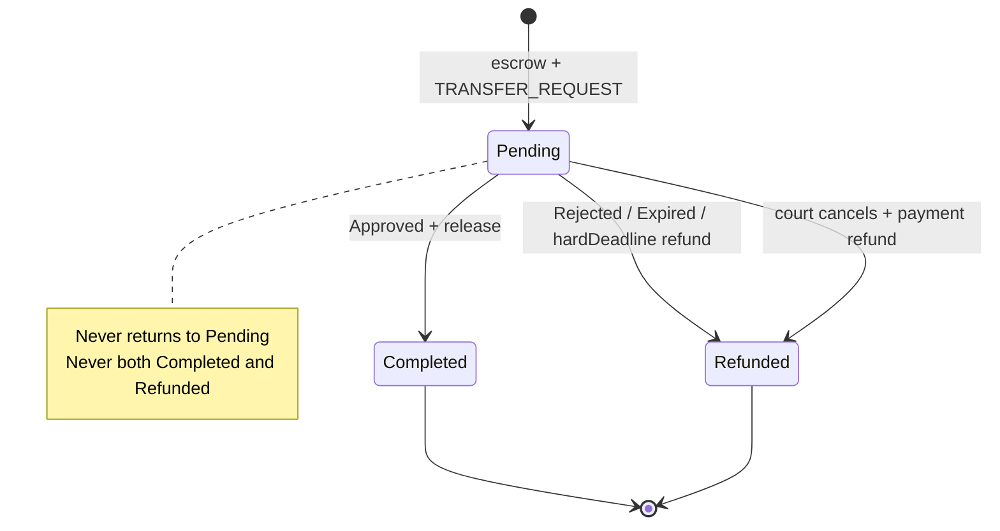

# Operational flowcharts — Legal Title Bridge

> 🌐 **English** · [Español](./flujograma-ES.md)

**Language:** English · Module 22 · **as-built** (TESTNET closed · SOLV closed 2026-11-23).  
**Source:** [`planificacion-EN.md`](./planificacion-EN.md) §6, §11–§12, D1–D6.  
**Companion:** [`diagrama-de-flujo-EN.md`](./diagrama-de-flujo-EN.md) (per-operation decisions).

End-to-end **operational** flowcharts: project phases, asset lifecycle, bridge, deadlines, and close on both testnets.

---

## 1. Master module flowchart (phases)



Each arrow requires: *"Autorizo Fase \<ID\>"* + exit criterion. Board: [`hitos-ES.md`](./hitos-ES.md).

---

## 2. Asset lifecycle (bonded warehouse wine)



---

## 3. Happy path — delivery versus payment



---

## 4. Rejection / expiry / D6 path



---

## 5. Deadline timeline (D4–D6)



---

## 6. Cross-chain messaging (closed enum)



---

## 7. Relayer pipeline



---

## 8. Security flowchart (CEI + anti-replay + pause)



---

## 9. Frontend — role walkthrough

```mermaid
flowchart TB
    HOME[/ /] --> EXP[/activos/assetId explorer]
    HOME --> CAR[/cartera Phantom]
    HOME --> OPE[/operador MetaMask]
    HOME --> VER[/verificador MetaMask]
    HOME --> PUE[/puente monitor]

    CAR --> C1[Sell / buy / refund]
    OPE --> O1[Issue / pause / court / D6]
    VER --> V1[Sign identity / certification]
    EXP --> E1[Recalculate ledger in browser]
    PUE --> P1[Messages + I2 green/red]

    C1 --> SIM[Simulate + decode before sign]
    O1 --> SIM
    V1 --> SIM
```

---

## 10. Path to both testnets (public acceptance)



---

## 11. Request states (I4)



---

## Quick reading

| Document | Question it answers |
|----------|---------------------|
| This flowchart | In what order does the system run end to end? |
| [`diagrama-de-flujo-EN.md`](./diagrama-de-flujo-EN.md) | Which if/else decides each operation? |
| [`diagrama-de-clases-EN.md`](./diagrama-de-clases-EN.md) | Which pieces exist and how do they relate? |
| [`mapa-de-ataques-ES.md`](./mapa-de-ataques-ES.md) | Which attacks run and against what? |
| [`superficie-de-ataques-ES.md`](./superficie-de-ataques-ES.md) | What can be touched from outside? |
