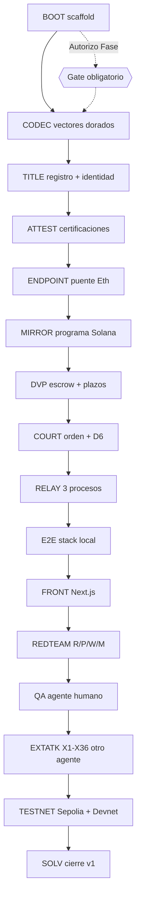
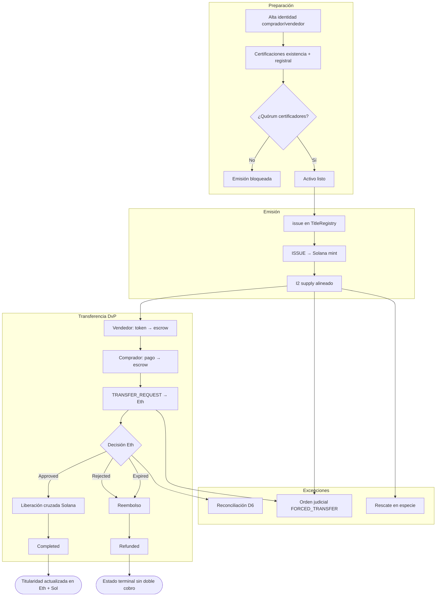
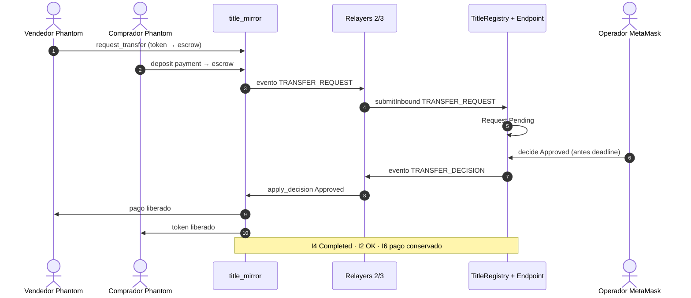
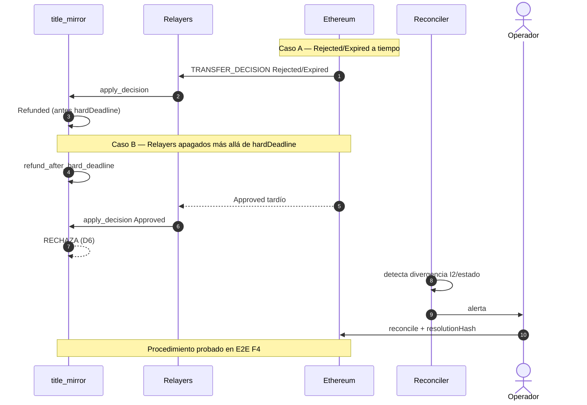
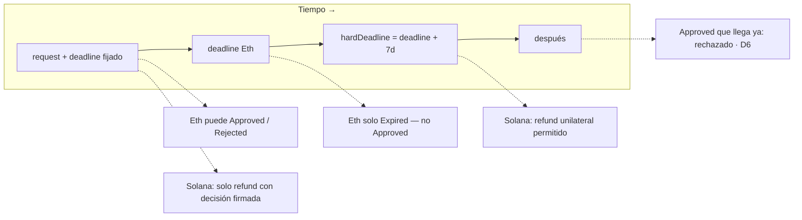
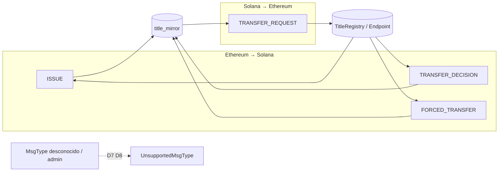
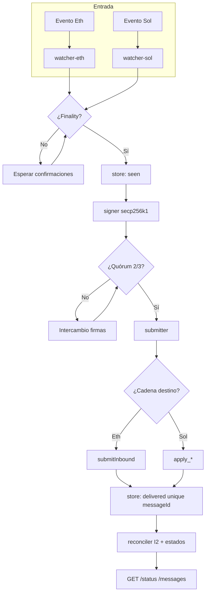
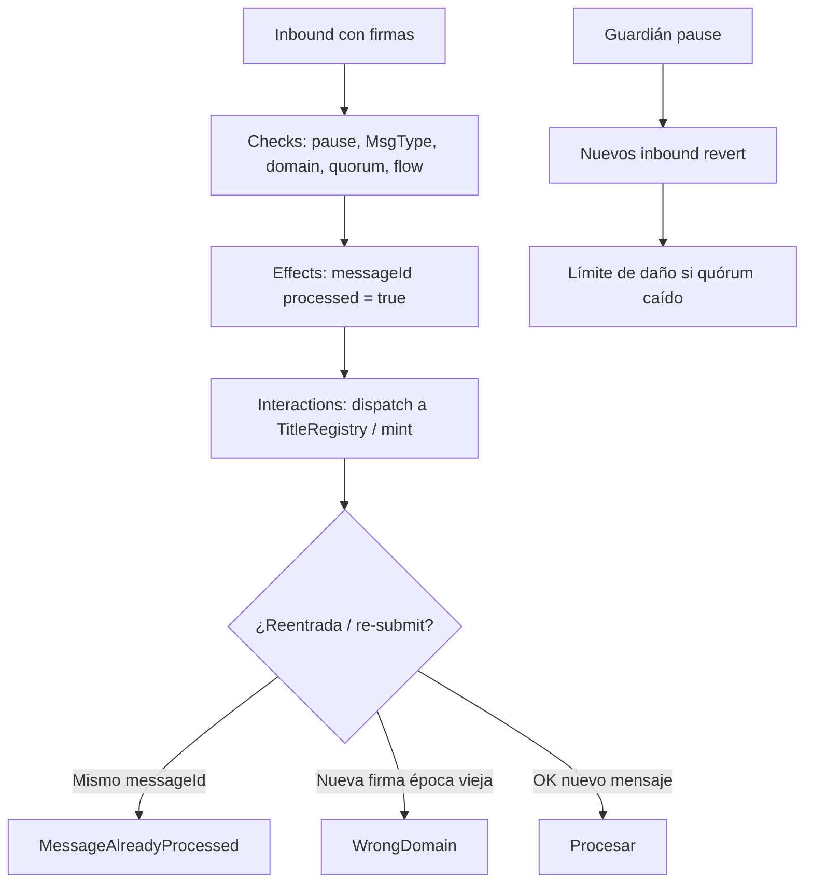
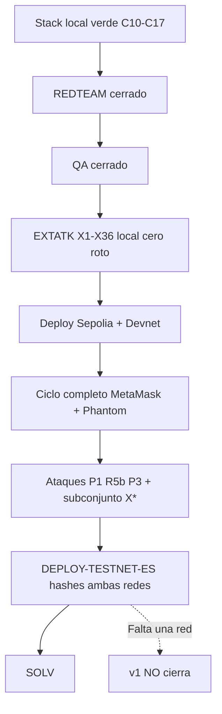
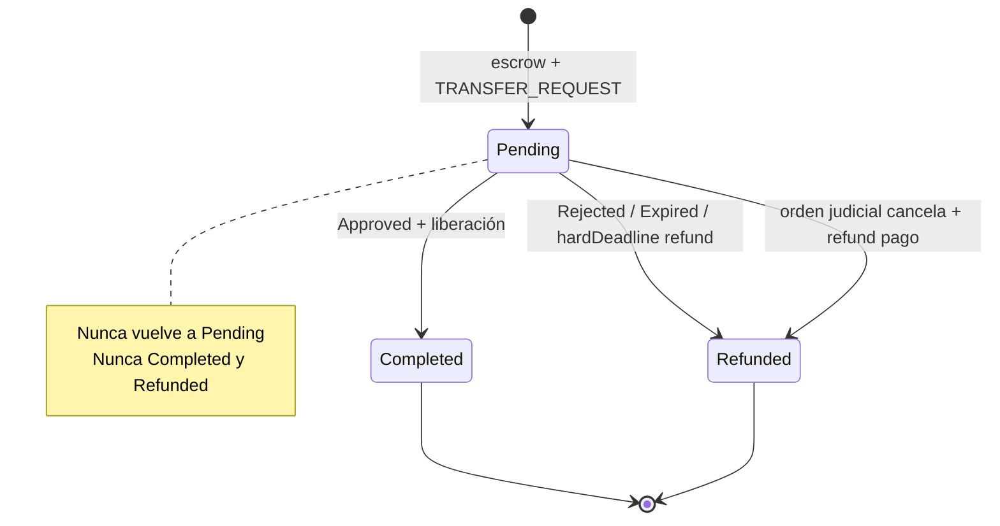

# Flujograma — Legal Title Bridge

> 🌐 **Español** · [English](./flujograma-EN.md)

**Idioma:** Español · Módulo 22 · **as-built** (TESTNET cerrada · SOLV en curso).  
**Fuente:** [`planificacion-ES.md`](./planificacion-ES.md) §6, §11–§12, D1–D6.  
**Companion:** [`diagrama-de-flujo-ES.md`](./diagrama-de-flujo-ES.md) (decisiones por operación).

Flujogramas **operativos** de punta a punta: fases del proyecto, ciclo de vida del activo, puente, plazos y cierre en ambas testnets.

---

## 1. Flujograma maestro del módulo (fases)



Cada flecha exige: *"Autorizo Fase \<ID\>"* + criterio de salida. Tablero: [`hitos-ES.md`](./hitos-ES.md).

---

## 2. Ciclo de vida del activo (vino en depósito fiscal)



---

## 3. Camino feliz — entrega contra pago



---

## 4. Camino de rechazo / vencimiento / D6



---

## 5. Línea de tiempo de plazos (D4–D6)



---

## 6. Mensajería entre cadenas (enum cerrado)



---

## 7. Pipeline del relayer



---

## 8. Flujograma de seguridad (CEI + anti-replay + pausa)



---

## 9. Frontend — recorrido por roles

```mermaid
flowchart TB
    HOME[/ /] --> EXP[/activos/assetId explorador]
    HOME --> CAR[/cartera Phantom]
    HOME --> OPE[/operador MetaMask]
    HOME --> VER[/verificador MetaMask]
    HOME --> PUE[/puente monitor]

    CAR --> C1[Vender / comprar / refund]
    OPE --> O1[Emitir / pausa / judicial / D6]
    VER --> V1[Firmar identidad / certificación]
    EXP --> E1[Recalcular ledger en browser]
    PUE --> P1[Mensajes + I2 verde/rojo]

    C1 --> SIM[Simular + decode antes de firmar]
    O1 --> SIM
    V1 --> SIM
```

---

## 10. Camino a ambas testnets (aceptación pública)



---

## 11. Estados de una solicitud (I4)



---

## Lectura rápida

| Documento | Pregunta que responde |
|-----------|----------------------|
| Este flujograma | ¿En qué orden ocurre el sistema de punta a punta? |
| [`diagrama-de-flujo-ES.md`](./diagrama-de-flujo-ES.md) | ¿Qué if/else decide cada operación? |
| [`diagrama-de-clases-ES.md`](./diagrama-de-clases-ES.md) | ¿Qué piezas existen y cómo se relacionan? |
| [`mapa-de-ataques-ES.md`](./mapa-de-ataques-ES.md) | ¿Qué ataques se ejecutan y contra qué? |
| [`superficie-de-ataques-ES.md`](./superficie-de-ataques-ES.md) | ¿Qué se puede tocar desde fuera? |
