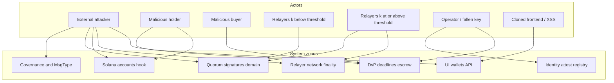
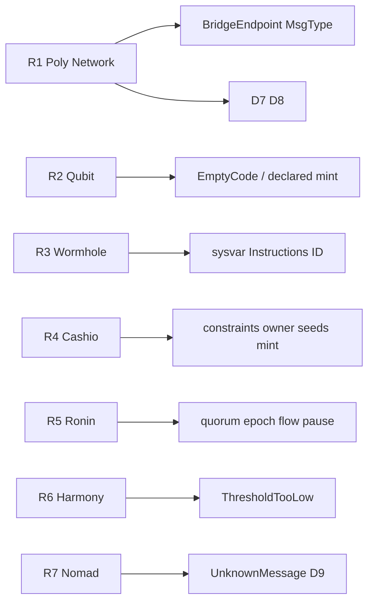
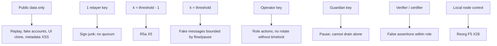

# Attack map — Legal Title Bridge

> 🌐 **English** · [Español](./mapa-de-ataques-ES.md)

**Language:** English · Module 22 · **to-be**.  
**Source:** [`planificacion-EN.md`](./planificacion-EN.md) §5, §10, §10.7.  
**Companion:** [`superficie-de-ataques-EN.md`](./superficie-de-ataques-EN.md) · future reports `RED-TEAM-ES`, `EXTATK-ES`, `QA-ES`.

Map of **what is attacked, from where, with what capability, and which control must stop it**. Not an exploit manual: cartography for REDTEAM, EXTATK, and TESTNET.

**Rule:** each REDTEAM attack first wins against a vulnerable variant (positive control) and fails against the real code.

---

## 1. Global map (threat → zone)

---

## 2. Summary matrix by catalog

| Catalog | Who runs it | Scope | Criterion |
|---------|-------------|-------|-----------|
| **R1–R7** | REDTEAM (repo) | Historical incidents with positive control | Success vs vulnerable; fail vs real |
| **P1–P9** | REDTEAM | Own protocol | Expected error / invariant |
| **F1–F5** | E2E | Induced network/relayer failures | I3/I4/D6 |
| **W1–W6** | REDTEAM + Playwright | Frontend | Positive control where applicable |
| **M1–M10** | Mutation | Remove one control | Some test must fail |
| **X1–X36** | **Another agent** EXTATK | Gray/black box | Zero `broken` locally; subset on testnet |

---

## 3. Real incidents (R) → component → control

| ID | Incident | Vector in this design | Control | Expected error / effect |
|----|----------|----------------------|---------|-------------------------|
| R1 | Poly Network | Payload/selector toward admin (relayers, roles, threshold) | D7, D8 closed enum | `UnsupportedMsgType`; set intact |
| R2 | Qubit | Token/payment without code or undeclared mint | `EmptyCode` / `token::mint` | Revert |
| R3 | Wormhole | Fake instructions sysvar | `address = Instructions::ID` + checked load | Constraint error; no mint |
| R4 | Cashio | Accounts with fake layout | `owner`, `seeds`, `has_one`, mint, authority | Constraint on each substitution |
| R5 | Ronin | (a) k−1 (b) removed relayer (c) drain with k | Quorum, epoch D11, flow+pause D12 | InvalidQuorum / WrongDomain / loss ≤ limit |
| R6 | Harmony | Low threshold on deploy/rotation | D10 | `ThresholdTooLow` |
| R7 | Nomad | Message “valid by default” / zero fields | D9 | `UnknownMessage` / `InvalidQuorum` |

---

## 4. Protocol attacks (P)

| ID | Attack | Zone | Control | Expected |
|----|--------|------|---------|----------|
| P1 | Replay same `messageId` | Z2 | MessageIdSet | `MessageAlreadyProcessed` |
| P2 | Replay cross-deploy / chain / epoch | Z2 | Domain D11 | `WrongDomain` |
| P3 | SPL transfer outside escrow | Z5 | Transfer hook I5 | Hook reject |
| P4 | Race refund vs late Approved | Z4 | D4–D6 | One terminal per chain; D6 reconciliable |
| P5 | Reentrancy from token with callback | Z4 (Eth test leg) | CEI + ReentrancyGuardTransient | Revert; balances OK |
| P6 | Buyer without identity / expired cert | Z3 | Identity + Attestation | `Rejected(...)` |
| P7 | Court order with tokens in escrow | Z4 | Cancel + payment refund + force | Payment to buyer; token to recipient |
| P8 | Zero amounts / overflow / > balance | Z1/Z4 | Codec + registry | Specific error |
| P9 | Front-run `refund` by third party | Z4 | Original owners only | Third party does not win |

---

## 5. Induced failures (F) — not “hacker”, chaos

| ID | Failure | Maps to | What it shows |
|----|---------|---------|---------------|
| F1 | Kill one relayer mid-flight | Z6 | Unique delivery I3 |
| F2 | Concurrent double delivery | Z6 | One OK, other AlreadyProcessed |
| F3 | Out of order (decision before ISSUE) | Z6 | Premature fails; retry OK |
| F4 | Relayers off > hardDeadline | Z4 | D5/D6 + reconcile |
| F5 | Anvil reorg post-event | Z6 | No delivery before finality |

---

## 6. Frontend (W)

| ID | Attack | UI surface | Control | Expected |
|----|--------|------------|---------|----------|
| W1 | XSS in asset name/description | Explorer | React escape; no `dangerouslySetInnerHTML`; Zod https; CSP | Literal text; vulnerable does execute |
| W2 | Wrong network / cluster | All actions | chainId + genesis | No signature |
| W3 | `?endpoint=` / `?program=` | Deep link | D14 shared/ | Ignored |
| W4 | DOM lies about amount/recipient | Confirmation | Decode + simulate real tx | UI = what is signed |
| W5 | Clickjacking iframe | Any route | `frame-ancestors 'none'` | Does not embed |
| W6 | Relayer API lies | `/puente` | “as reported” label; balances from chain | Does not enable fake actions |

---

## 7. EXTATK (X1–X36) — map by family

### A — Bridge and quorum

| ID | Idea | Crosses with |
|----|------|--------------|
| X1 | Swap src/dst with same signatures | P2, D11 |
| X2 | Mutate 1 byte post-signature | codec / digest |
| X3 | Same id, different MsgType | P1, D8 |
| X4 | Old epoch Eth↔Sol | R5b, D11 |
| X5 | k−1 + junk/duplicate signatures | R5a |
| X6 | Two coalitions in parallel | I3 |
| X7 | Fragment to evade flow | R5c, D12 |
| X8 | Asymmetric pause | D12 |

### B — Registry / identity / attest

| ID | Idea | Crosses with |
|----|------|--------------|
| X9 | EIP-712 from another deploy | domain |
| X10 | Cert expires between decide and release | I7, P6 |
| X11 | Revoke identity in flight | P6 |
| X12 | Certifier quorum with double signature | ATTEST |
| X13 | Frozen/Paused with Pending | states |
| X14 | Lying RPC in ledger explorer | I9 UI |

### C — DvP / deadlines / D6

| ID | Idea | Crosses with |
|----|------|--------------|
| X15 | Race at hardDeadline slot | P4 |
| X16 | Refund by third party | P9 |
| X17 | Different payment mint | R2/R4 |
| X18 | Partial deposit | I6 |
| X19 | Cancel after deposit | I4 |
| X20 | Duplicate reconcile | D6 |
| X21 | Reconcile without anchor | D6 |

### D — Solana accounts / hook

| ID | Idea | Crosses with |
|----|------|--------------|
| X22 | Cashio account matrix | R4 |
| X23 | Fake sysvar | R3 |
| X24 | CPI intermediary bypass hook | P3, I5 |
| X25 | Delegate / burn / close paths | I5 |
| X26 | Zombie escrow PDA | seeds |
| X27 | Mint with smuggled extensions | canonical mint |

### E — Relayer / network

| ID | Idea | Crosses with |
|----|------|--------------|
| X28 | Reorg confirmations−1 | F5 |
| X29 | Synthetic event topics | watcher address |
| X30 | Fake status API | W6 |
| X31 | Sign foreign emitter | D11 |
| X32 | Griefing flow limit | D12 |

### F — UI / human

| ID | Idea | Crosses with |
|----|------|--------------|
| X33 | Cloned UI different shared | W2–W4 |
| X34 | EIP-712 alias / field order | wallet |
| X35 | Unicode / RTL homographs | W1 family |
| X36 | Deep link prefill amounts | W3/W4 |

**Testnet (mandatory subset):** X1, X4, X7, X15, X17, X23, X25, X33 (+ X28 if applicable).

---

## 8. Mutants (M) — map “if I remove this, who catches it?”

| Mutant | Control removed | Tests that must fail (family) |
|--------|-----------------|-------------------------------|
| M1 | Mark messageId | P1, I3, R7 |
| M2 | Epoch in digest | P2, R5b, X4 |
| M3 | Check deadline approve | D4, P4 |
| M4 | Certification validity | P6, I7 |
| M5 | Buyer identity | P6, I7 |
| M6 | Flow limit | R5c, X7 |
| M7 | Threshold ≥ ⌈2n/3⌉ | R6, I8 |
| M8 | Sysvar Instructions address | R3, X23 |
| M9 | payment token::mint | R2/R4, X17 |
| M10 | Owner in hook | P3, I5, X24/X25 |

---

## 9. Attacker capability map → what they can try

---

## 10. Coverage by invariant

| Invariant | Attacks that stress it |
|-----------|------------------------|
| I1 | COURT, redeem, malicious reconcile X20 |
| I2 | Fake ISSUE, D6, F4, reconciler |
| I3 | P1, F1, F2, X6 |
| I4 | P4, P7, X15, X19 |
| I5 | P3, X24, X25, M10 |
| I6 | X16, X18, P9 |
| I7 | P6, X10, X11, M4, M5 |
| I8 | R6, M7 |
| I9 | X14, ledger fuzz |

---

## 11. Map status (tracking)

| Block | Results doc | Status |
|-------|-------------|--------|
| R / P / W / M | `RED-TEAM-ES.md` | ✅ REDTEAM 2026-11-20 · `make check-redteam` |
| F | E2E + notes in RED-TEAM | ✅ F1–F5 in `e2e/test/failures.test.ts` (C10) · REDTEAM detail pending |
| X | `EXTATK-ES.md` | ⏳ EXTATK pending |
| QA (not exploit) | `QA-ES.md` | ⏳ QA pending |
| Testnet | `DEPLOY-TESTNET-ES.md` | ⏳ TESTNET pending |

When closing each phase, mark IDs here with `blocked` / evidence (test file or hash).
