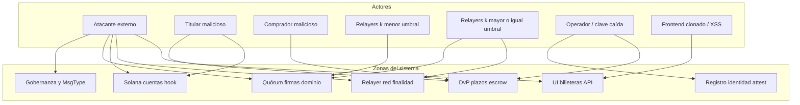
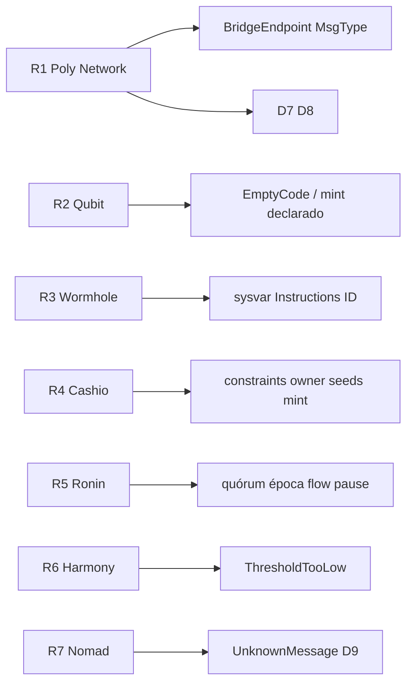
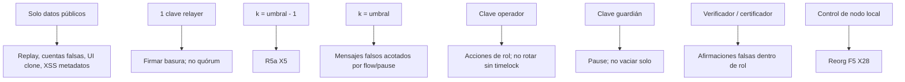

# Mapa de posibles ataques — Legal Title Bridge

**Idioma:** Español · Módulo 22 · **to-be**.  
**Fuente:** [`planificacion-ES.md`](./planificacion-ES.md) §5, §10, §10.7.  
**Companion:** [`superficie-de-ataques-ES.md`](./superficie-de-ataques-ES.md) · informes futuros `RED-TEAM-ES`, `EXTATK-ES`, `QA-ES`.

Mapa de **qué se ataca, desde dónde, con qué capacidad y qué control debe pararlo**. No es un manual de exploit: es la cartografía para REDTEAM, EXTATK y TESTNET.

**Regla:** cada ataque de REDTEAM gana primero contra variante vulnerable (control positivo) y falla contra el código real.

---

## 1. Mapa global (amenaza → zona)

---

## 2. Matriz resumen por catálogo

| Catálogo | Quién lo corre | Alcance | Criterio |
|----------|----------------|---------|----------|
| **R1–R7** | REDTEAM (repo) | Incidentes históricos con control positivo | Éxito vs vulnerable; fallo vs real |
| **P1–P9** | REDTEAM | Protocolo propio | Error esperado / invariante |
| **F1–F5** | E2E | Fallas inducidas de red/relayer | I3/I4/D6 |
| **W1–W6** | REDTEAM + Playwright | Frontend | Control positivo donde aplica |
| **M1–M10** | Mutación | Quitar un control | Algún test debe fallar |
| **X1–X36** | **Otro agente** EXTATK | Caja gris/negra | Cero `roto` en local; subconjunto en testnet |

---

## 3. Incidentes reales (R) → componente → control

| ID | Incidente | Vector en este diseño | Control | Error / efecto esperado |
|----|-----------|----------------------|---------|-------------------------|
| R1 | Poly Network | Payload/selector hacia admin (relayers, roles, umbral) | D7, D8 enum cerrado | `UnsupportedMsgType`; set intacto |
| R2 | Qubit | Token/pago sin código o mint no declarado | `EmptyCode` / `token::mint` | Revert |
| R3 | Wormhole | Sysvar de instrucciones falso | `address = Instructions::ID` + checked load | Constraint error; sin mint |
| R4 | Cashio | Cuentas con layout falso | `owner`, `seeds`, `has_one`, mint, authority | Constraint en cada sustitución |
| R5 | Ronin | (a) k−1 (b) relayer removido (c) vaciado con k | Quórum, época D11, flow+pausa D12 | InvalidQuorum / WrongDomain / pérdida ≤ límite |
| R6 | Harmony | Umbral bajo en deploy/rotación | D10 | `ThresholdTooLow` |
| R7 | Nomad | Mensaje “válido por defecto” / campos cero | D9 | `UnknownMessage` / `InvalidQuorum` |

---

## 4. Ataques del protocolo (P)

| ID | Ataque | Zona | Control | Esperado |
|----|--------|------|---------|----------|
| P1 | Replay mismo `messageId` | Z2 | MessageIdSet | `MessageAlreadyProcessed` |
| P2 | Replay cross-deploy / chain / época | Z2 | Domain D11 | `WrongDomain` |
| P3 | Transfer SPL fuera del escrow | Z5 | Transfer hook I5 | Hook reject |
| P4 | Carrera refund vs Approved tardío | Z4 | D4–D6 | Un terminal por cadena; D6 reconciliable |
| P5 | Reentrada desde token con callback | Z4 (tramo Eth de prueba) | CEI + ReentrancyGuardTransient | Revert; saldos OK |
| P6 | Comprador sin identidad / cert vencida | Z3 | Identity + Attestation | `Rejected(...)` |
| P7 | Orden judicial con tokens en escrow | Z4 | Cancel + refund pago + force | Pago al buyer; token al destinatario |
| P8 | Montos cero / overflow / > saldo | Z1/Z4 | Códec + registro | Error específico |
| P9 | Front-run `refund` por tercero | Z4 | Solo dueños originales | Tercero no gana |

---

## 5. Fallas inducidas (F) — no son “hacker”, son caos

| ID | Falla | Mapa a | Qué demuestra |
|----|-------|--------|---------------|
| F1 | Matar un relayer a mitad | Z6 | Entrega única I3 |
| F2 | Doble entrega concurrente | Z6 | Uno OK, otro AlreadyProcessed |
| F3 | Fuera de orden (decisión antes que ISSUE) | Z6 | Prematura falla; retry OK |
| F4 | Relayers off > hardDeadline | Z4 | D5/D6 + reconcile |
| F5 | Reorg anvil post-evento | Z6 | No entrega antes de finality |

---

## 6. Frontend (W)

| ID | Ataque | Superficie UI | Control | Esperado |
|----|--------|---------------|---------|----------|
| W1 | XSS en nombre/descripción activo | Explorador | Escape React; no `dangerouslySetInnerHTML`; Zod https; CSP | Texto literal; vulnerable sí ejecuta |
| W2 | Red / cluster equivocado | Todas las acciones | chainId + genesis | Sin firma |
| W3 | `?endpoint=` / `?program=` | Deep link | D14 shared/ | Ignorado |
| W4 | DOM miente monto/destinatario | Confirmación | Decode + simulate de la tx real | UI = lo firmado |
| W5 | Clickjacking iframe | Cualquier ruta | `frame-ancestors 'none'` | No embebe |
| W6 | API relayer miente | `/puente` | Etiqueta “informado”; saldos desde cadena | No habilita acciones falsas |

---

## 7. EXTATK (X1–X36) — mapa por familia

### A — Puente y quórum

| ID | Idea | Cruza con |
|----|------|-----------|
| X1 | Invertir src/dst con mismas firmas | P2, D11 |
| X2 | Mutar 1 byte post-firma | códec / digest |
| X3 | Mismo id, otro MsgType | P1, D8 |
| X4 | Época vieja Eth↔Sol | R5b, D11 |
| X5 | k−1 + firmas basura/duplicadas | R5a |
| X6 | Dos coaliciones en paralelo | I3 |
| X7 | Fragmentar para evadir flow | R5c, D12 |
| X8 | Pause asimétrica | D12 |

### B — Registro / identidad / attest

| ID | Idea | Cruza con |
|----|------|-----------|
| X9 | EIP-712 de otro deploy | domain |
| X10 | Cert vence entre decide y release | I7, P6 |
| X11 | Revoke identidad en vuelo | P6 |
| X12 | Quórum certificador con doble firma | ATTEST |
| X13 | Frozen/Paused con Pending | estados |
| X14 | RPC mentiroso en ledger explorer | I9 UI |

### C — DvP / plazos / D6

| ID | Idea | Cruza con |
|----|------|-----------|
| X15 | Carrera slot hardDeadline | P4 |
| X16 | Refund por tercero | P9 |
| X17 | Payment mint distinto | R2/R4 |
| X18 | Depósito parcial | I6 |
| X19 | Cancel tras depósito | I4 |
| X20 | Reconcile duplicado | D6 |
| X21 | Reconcile sin ancla | D6 |

### D — Solana cuentas / hook

| ID | Idea | Cruza con |
|----|------|-----------|
| X22 | Matriz Cashio cuentas | R4 |
| X23 | Sysvar falso | R3 |
| X24 | CPI intermediario bypass hook | P3, I5 |
| X25 | Delegate / burn / close paths | I5 |
| X26 | PDA escrow zombie | seeds |
| X27 | Mint con extensiones coladas | mint canónico |

### E — Relayer / red

| ID | Idea | Cruza con |
|----|------|-----------|
| X28 | Reorg confirmations−1 | F5 |
| X29 | Evento sintético topics | watcher address |
| X30 | API status falsa | W6 |
| X31 | Firmar emitter ajeno | D11 |
| X32 | Griefing flow limit | D12 |

### F — UI / humano

| ID | Idea | Cruza con |
|----|------|-----------|
| X33 | UI clonada shared distinto | W2–W4 |
| X34 | EIP-712 alias / orden campos | billetera |
| X35 | Homógrafos Unicode / RTL | W1 familia |
| X36 | Deep link prefill montos | W3/W4 |

**Testnet (subconjunto obligatorio):** X1, X4, X7, X15, X17, X23, X25, X33 (+ X28 si aplica).

---

## 8. Mutantes (M) — mapa “si quito esto, ¿quién lo caza?”

| Mutante | Control quitado | Tests que deben fallar (familia) |
|---------|-----------------|----------------------------------|
| M1 | Marcar messageId | P1, I3, R7 |
| M2 | Época en digest | P2, R5b, X4 |
| M3 | Check deadline approve | D4, P4 |
| M4 | Vigencia certificación | P6, I7 |
| M5 | Identidad comprador | P6, I7 |
| M6 | Flow limit | R5c, X7 |
| M7 | Umbral ≥ ⌈2n/3⌉ | R6, I8 |
| M8 | Sysvar Instructions address | R3, X23 |
| M9 | token::mint del pago | R2/R4, X17 |
| M10 | Dueño en hook | P3, I5, X24/X25 |

---

## 9. Mapa capacidad del atacante → qué puede intentar

---

## 10. Cobertura por invariante

| Invariante | Ataques que la tensionan |
|------------|--------------------------|
| I1 | COURT, redeem, reconcile malicioso X20 |
| I2 | ISSUE falso, D6, F4, reconciler |
| I3 | P1, F1, F2, X6 |
| I4 | P4, P7, X15, X19 |
| I5 | P3, X24, X25, M10 |
| I6 | X16, X18, P9 |
| I7 | P6, X10, X11, M4, M5 |
| I8 | R6, M7 |
| I9 | X14, fuzz ledger |

---

## 11. Estado del mapa (seguimiento)

| Bloque | Doc de resultados | Estado |
|--------|-------------------|--------|
| R / P / W / M | `RED-TEAM-ES.md` | ⏳ Pendiente fase REDTEAM |
| F | E2E + notas en RED-TEAM | ⏳ Pendiente E2E |
| X | `EXTATK-ES.md` | ⏳ Pendiente EXTATK |
| QA (no exploit) | `QA-ES.md` | ⏳ Pendiente QA |
| Testnet | `DEPLOY-TESTNET-ES.md` | ⏳ Pendiente TESTNET |

Al cerrar cada fase, marcar aquí los IDs con `bloqueado` / evidencia (archivo de test o hash).
