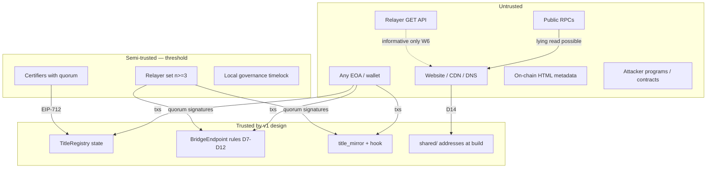
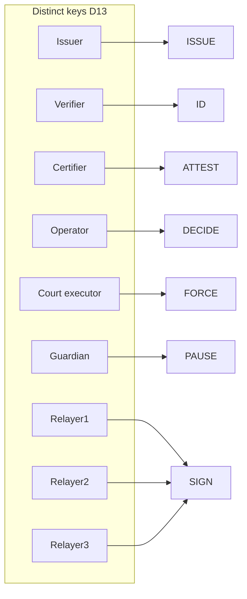

# Attack surface — Legal Title Bridge

> 🌐 **English** · [Español](./superficie-de-ataques-ES.md)

**Language:** English · Module 22 · **to-be**.  
**Source:** [`planificacion-EN.md`](./planificacion-EN.md) §2–§6, D7–D14.  
**Companion:** [`mapa-de-ataques-EN.md`](./mapa-de-ataques-EN.md).

Inventory of **everything an adversary can touch or observe**: on-chain inputs, APIs, UI, keys, public data, and trust boundaries. If it is not on this list, it should not be assumed as a v1 surface.

---

## 1. Trust boundaries



**Principle:** Ethereum is the source of truth (D1). Solana executes effects only after valid messages. The frontend is **not** trusted as truth (D14).

---

## 2. Ethereum surface (contracts)

### 2.1 External / public functions (targets)

| Contract | Callable inputs | Who should call | Risk if control fails |
|----------|-----------------|-----------------|----------------------|
| `TitleRegistry` | `issue`, `decide`, `forcedTransfer`, `reconcile`, `redeemInKind`, getters | roles D13 | Fake issuance, double truth, broken entry |
| `IdentityRegistry` | `registerAssertion`, `revoke`, getters | verifier | Fake / permanent KYC |
| `AttestationRegistry` | `attest`, getters | certifiers | Issuance without basis |
| `BridgeEndpoint` | `submitInbound`, `emitOutbound` (internal/role), `pause`, `rotateRelayers` | relayers / guardian / timelock | Ghost mint/transfer; governance (mitigated D7) |
| Compliance modules | config by operator | operator | Transfer-rule bypass |

### 2.2 Readable data (always public)

- Balances `(assetId, holder)`.
- Asset and `TransferRequest` states.
- `entryHash` chain.
- Assertions and certifications (incl. expiries).
- Relayer set, `epoch`, `threshold`, flow-limit consumption.
- Message events (observable payloads → reusable signatures in replay trials).

### 2.3 Ethereum signing surface

| Mechanism | Surface | Typical attack |
|-----------|---------|----------------|
| EIP-712 identities / attest | Domain (`chainId`, `verifyingContract`, name/version) | Cross-deploy reuse (X9) |
| Relayer packet digest | version, chains, emitter, epoch, payload | Cross-domain replay (P2, X1–X4) |
| Rotation timelock | delay + proposal | Compromised operator without wait |

### 2.4 Outside message surface (D7)

There **must not** be a cross-chain entry to: change relayers, threshold, AccessControl roles, upgrade/code, or remote pause from the other chain.

---

## 3. Solana surface (`title_mirror`)

### 3.1 Instructions

| Instruction | Sensitive accounts | Minimum validations |
|-------------|--------------------|---------------------|
| `initialize_config` / `rotate_relayers` | Config PDA | Threshold D10; local governance |
| `apply_issue` | Config, mint, ATA, sysvar Ix, signatures | Quorum, domain, canonical mint |
| `request_transfer` | Escrow PDA, title token, authorities | Hook path; seeds |
| payment deposit | payment mint/ATA | declared `token::mint` |
| `apply_decision` | Escrow, ATAs, sysvar | Pending state; D5 |
| `refund_after_hard_deadline` | Escrow | Time; original beneficiaries |
| `apply_forced_transfer` | permanent delegate PDA | Only after valid message |
| **transfer hook** | ExtraAccountMetaList | Default reject I5 |

### 3.2 Objects the attacker can fabricate

- Own program with same-layout accounts (R4/X22).
- Token-2022 mint with extra extensions (X27).
- Fake Instructions sysvar (R3/X23).
- Token account with wrong mint/authority.
- PDA with different seeds after close (X26).

### 3.3 Token movement paths (I5)

| Path | Allowed? |
|------|----------|
| To/from program escrow | Yes |
| Release via `apply_decision` | Yes |
| Permanent delegate via `FORCED_TRANSFER` | Yes |
| Holder→holder `transfer_checked` | **No** |
| Arbitrary delegate / burn / creative close | **No** (unless explicitly documented design) |
| CPI from intermediary program | **No** (X24) |

---

## 4. Bridge surface (message)

### 4.1 Closed enum (`MsgType`)

| Type | Direction | Effect | Cannot |
|------|-----------|--------|--------|
| `ISSUE` | Eth→Sol | Mint N | Govern |
| `TRANSFER_REQUEST` | Sol→Eth | Open request | Approve alone |
| `TRANSFER_DECISION` | Eth→Sol | Release / refund | Create new supply |
| `FORCED_TRANSFER` | Eth→Sol | Move via delegate | Rotate relayers |
| `0x??` other | — | — | `UnsupportedMsgType` |

### 4.2 Domain fields in the digest (always a signing surface)

```
version | srcChain | dstChain | emitter | epoch | msgType | payload...
messageId = keccak256(packet)
```

Any omission in the digest **widens** the replay surface.

### 4.3 Anti-replay

| Layer | What it covers |
|-------|----------------|
| `messageId` set per chain | Local replay P1 |
| Full domain | Cross-chain/deploy/epoch replay P2 |
| Unknown default state | Nomad R7 |

---

## 5. Relayer surface

| Piece | Exposure | Risk | Mitigation |
|-------|----------|------|------------|
| secp256k1 key per process | Relayer host | Hostile signature | 2/3 threshold; rotation; single key not enough |
| Eth/Sol watcher | RPC | Fake event / reorg | Filter contract `address`; wait for finality |
| SQLite store | Local disk | Corruption / double | UNIQUE messageId; F1/F2 tests |
| Submitter | Mempool | Harmless submit front-run (permissive) | Effect only with signatures; idempotency |
| **HTTP status-api** | Network | Lie about states | **GET only**; UI does not trust for balances (W6) |
| Signature exchange | Network among relayers | Public reusable signatures | Bind only to that digest |

There is **no** write HTTP surface: nobody “orders” the relayer via API.

---

## 6. Frontend surface

| Surface | Input | Trust | Control |
|---------|-------|-------|---------|
| App Router routes | URL path | Low | `not-found` / id validation |
| Query params | `?endpoint=` `?program=` amounts | **Zero** for addresses | Ignore; shared/ only W3 |
| Forms | Amounts, recipients | Low until encode | Confirmation = decode tx W4 |
| Asset metadata | on-chain string | Do not execute | Escape / CSP W1 |
| Wallet EIP-1193 / Phantom | Accounts, network | User | Guards W2 |
| RPC read | State | RPC may lie | Cross-check / no blind signing |
| Relayer API | JSON | Informative | Badge; does not enable tx W6 |
| Build bundle | Artifact | Supply chain | C17 without E2E keys |
| iframe embed | Clickjack | — | frame-ancestors W5 |
| i18n strings | ES/EN | Low | Do not interpolate raw HTML |

---

## 7. Roles and keys surface



| Compromise | Damage radius bounded by |
|------------|--------------------------|
| 1 relayer | No quorum |
| 2 of 3 relayers | Flow limit + guardian pause |
| Operator | Timelock on rotations; cannot bypass I7 alone |
| Guardian | Can stop; cannot drain |
| Verifier | Fake identities until detected/revoke |
| Issuer | Metadata + issue attempts (still needs attest) |

Deploy must revert with **`RoleOverlap`** if two critical roles share a key.

---

## 8. Temporal surface (deadlines)

| Window | Who can do what | Abuse surface |
|--------|-----------------|---------------|
| `now <= deadline` | Eth `Approved`/`Rejected` | Premature decision / late race P4 |
| `deadline < now` | Eth only `Expired` | Late approve (must fail D4) |
| `now < hardDeadline` | Solana refund only with signed decision | Early local refund (forbidden D5) |
| `now >= hardDeadline` | Unilateral refund | Third-party P9; then late Approved → D6 |

---

## 9. Network / ops surface

| Element | Surface | v1 notes |
|---------|---------|----------|
| anvil / solana-test-validator | Total (lab) | Local REDTEAM / E2E / EXTATK |
| Sepolia RPC | Public read/write | TESTNET; no real-value funds |
| Solana Devnet | Same | Mandatory TESTNET alongside Sepolia |
| DNS / frontend hosting | Phishing | W2–W4; no mainnet |
| CI logs / `.env` | Secrets | `.env.example` without secrets; C17 |

**Outside v1 surface (excluded):** mainnet, light clients, commercial messaging (Wormhole/CCIP/LZ), mobile app, EUDI wallet.

---

## 10. Asset data surface (off-code)

| Risk | In code? | Treatment |
|------|----------|-----------|
| Issuer lies about physical wine | No | Signed certification by name; residual article risk |
| Bonded warehouse custodian | No | Outside v1 on-chain |
| Valuation / price | No | Excluded (no price oracles) |

---

## 11. Surface-reduction checklist (design)

- [ ] Closed `MsgType` enum; no arbitrary `call`
- [ ] Digest with full domain (chains, emitter, epoch)
- [ ] One-shot messageId per chain
- [ ] Default state ≠ approved
- [ ] Threshold ≥ ⌈2n/3⌉, n ≥ 3
- [ ] Flow limit + pause
- [ ] Non-overlapping roles
- [ ] Deny-by-default hook
- [ ] Instructions sysvar bound to ID
- [ ] Payment mint bound
- [ ] Read-only relayer API
- [ ] Frontend: shared/ only, simulate+decode, CSP, no iframe
- [ ] Explicit and tested D4–D6 deadlines

---

## 12. How to use this document

1. In **BOOT/CODEC**: confirm no new surface opens (HTTP write, free MsgType, etc.).
2. In each contract/program phase: map every new function to the §2/§3 table.
3. In **REDTEAM/EXTATK**: every attack must cite a surface row (“I enter via X with capability Y”).
4. In **TESTNET**: the real surface is the addresses published in `DEPLOY-TESTNET-ES.md` — update this doc with those endpoints when closing.
