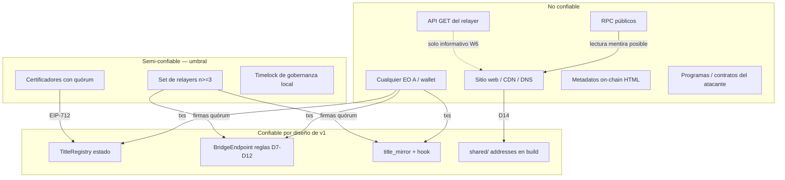
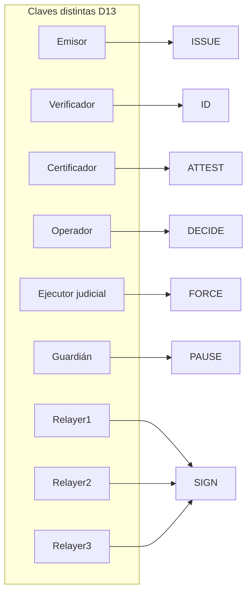

# Superficie de ataques — Legal Title Bridge

**Idioma:** Español · Módulo 22 · **to-be**.  
**Fuente:** [`planificacion-ES.md`](./planificacion-ES.md) §2–§6, D7–D14.  
**Companion:** [`mapa-de-ataques-ES.md`](./mapa-de-ataques-ES.md).

Inventario de **todo lo que un adversario puede tocar o observar**: entradas on-chain, APIs, UI, claves, datos públicos y fronteras de confianza. Si no está en esta lista, no debería ser asumible como superficie en v1.

---

## 1. Fronteras de confianza



**Principio:** Ethereum es fuente de verdad (D1). Solana ejecuta efectos solo tras mensajes válidos. El frontend **no** es confiable como verdad (D14).

---

## 2. Superficie Ethereum (contratos)

### 2.1 Funciones externas / públicas (objetivos)

| Contrato | Entradas llamables | Quién debería llamar | Riesgo si falla el control |
|----------|--------------------|----------------------|----------------------------|
| `TitleRegistry` | `issue`, `decide`, `forcedTransfer`, `reconcile`, `redeemInKind`, getters | roles D13 | Emisión falsa, doble verdad, asiento roto |
| `IdentityRegistry` | `registerAssertion`, `revoke`, getters | verificador | KYC falso / permanente |
| `AttestationRegistry` | `attest`, getters | certificadores | Emisión sin base |
| `BridgeEndpoint` | `submitInbound`, `emitOutbound` (interno/rol), `pause`, `rotateRelayers` | relayers / guardián / timelock | Mint/transferencia fantasma; gobernanza (mitigado D7) |
| Compliance modules | config por operador | operador | Bypass de reglas de transferencia |

### 2.2 Datos legibles (siempre públicos)

- Saldos `(assetId, holder)`.
- Estados de activo y de `TransferRequest`.
- Cadena de `entryHash`.
- Afirmaciones y certificaciones (incl. vencimientos).
- Set de relayers, `epoch`, `threshold`, consumo de flow limit.
- Eventos de mensajes (payloads observables → firmas reutilizables en replay trials).

### 2.3 Superficie de firma Ethereum

| Mecanismo | Superficie | Ataque típico |
|-----------|------------|---------------|
| EIP-712 identidades / attest | Domain (`chainId`, `verifyingContract`, nombre/versión) | Reuso cross-deploy (X9) |
| Digest de paquete relayer | version, chains, emitter, epoch, payload | Replay cross-domain (P2, X1–X4) |
| Timelock rotación | delay + propuesta | Operador comprometido sin wait |

### 2.4 Fuera de superficie de mensaje (D7)

**No** debe existir entrada cross-chain hacia: cambiar relayers, umbral, roles AccessControl, upgrade/código, pausa remota desde la otra cadena.

---

## 3. Superficie Solana (`title_mirror`)

### 3.1 Instrucciones

| Instrucción | Cuentas sensibles | Validaciones mínimas |
|-------------|-------------------|----------------------|
| `initialize_config` / `rotate_relayers` | Config PDA | Umbral D10; gobernanza local |
| `apply_issue` | Config, mint, ATA, sysvar Ix, firmas | Quórum, domain, mint canónico |
| `request_transfer` | Escrow PDA, token título, authorities | Hook path; seeds |
| depósito de pago | payment mint/ATA | `token::mint` declarado |
| `apply_decision` | Escrow, ATAs, sysvar | Estado Pending; D5 |
| `refund_after_hard_deadline` | Escrow | Tiempo; beneficiarios originales |
| `apply_forced_transfer` | permanent delegate PDA | Solo tras mensaje válido |
| **transfer hook** | ExtraAccountMetaList | Rechazo default I5 |

### 3.2 Objetos que el atacante puede fabricar

- Programa propio con cuentas same-layout (R4/X22).
- Mint Token-2022 con extensiones extra (X27).
- Sysvar Instructions falso (R3/X23).
- Token account con mint/authority incorrectos.
- PDA con seeds distintas tras cierre (X26).

### 3.3 Caminos de movimiento de tokens (I5)

| Camino | ¿Permitido? |
|--------|-------------|
| Hacia/desde escrow del programa | Sí |
| Liberación por `apply_decision` | Sí |
| Permanent delegate por `FORCED_TRANSFER` | Sí |
| `transfer_checked` titular→titular | **No** |
| Delegate arbitrario / burn / close creativo | **No** (salvo diseño explícito documentado) |
| CPI desde programa intermediario | **No** (X24) |

---

## 4. Superficie del puente (mensaje)

### 4.1 Enum cerrado (`MsgType`)

| Tipo | Dirección | Efecto | No puede |
|------|-----------|--------|----------|
| `ISSUE` | Eth→Sol | Mint N | Gobernar |
| `TRANSFER_REQUEST` | Sol→Eth | Abrir request | Aprobar sola |
| `TRANSFER_DECISION` | Eth→Sol | Liberar / refund | Crear supply nuevo |
| `FORCED_TRANSFER` | Eth→Sol | Mover por delegate | Rotar relayers |
| `0x??` otro | — | — | `UnsupportedMsgType` |

### 4.2 Campos del dominio en el digest (siempre superficie de firma)

```
version | srcChain | dstChain | emitter | epoch | msgType | payload...
messageId = keccak256(paquete)
```

Cualquier omisión en el digest **amplía** la superficie de replay.

### 4.3 Anti-replay

| Capa | Qué cubre |
|------|-----------|
| `messageId` set por cadena | Replay local P1 |
| Domain completo | Replay cross-chain/deploy/época P2 |
| Estado default desconocido | Nomad R7 |

---

## 5. Superficie relayer

| Pieza | Exposición | Riesgo | Mitigación |
|-------|-----------|--------|------------|
| Clave secp256k1 por proceso | Host del relayer | Firma hostil | Umbral 2/3; rotación; no una sola clave basta |
| Watcher Eth/Sol | RPC | Evento falso / reorg | Filtrar `address` del contrato; esperar finality |
| Store SQLite | Disco local | Corrupción / doble | UNIQUE messageId; tests F1/F2 |
| Submitter | Mempool | Front-run submit inofensivo (permisivo) | Efecto solo con firmas; idempotencia |
| **HTTP status-api** | Red | Mentir estados | **Solo GET**; UI no confía para saldos (W6) |
| Intercambio de firmas | Red entre relayers | Firmas públicas reutilizables | Atañen solo a ese digest |

**No hay** superficie HTTP de escritura: nadie “ordena” al relayer por API.

---

## 6. Superficie frontend

| Superficie | Entrada | Confianza | Control |
|------------|---------|-----------|---------|
| Rutas App Router | URL path | Baja | `not-found` / validación ids |
| Query params | `?endpoint=` `?program=` montos | **Cero** para direcciones | Ignorar; shared/ only W3 |
| Formularios | Montos, destinatarios | Baja hasta encode | Confirmación = decode tx W4 |
| Metadatos activo | string on-chain | No ejecutar | Escape / CSP W1 |
| Wallet EIP-1193 / Phantom | Cuentas, red | Usuario | Guardas W2 |
| Lectura RPC | Estado | RPC puede mentir | Contrastar / no firmar ciego |
| API relayer | JSON | Informativa | Badge; no habilita tx W6 |
| Build bundle | Artefacto | Supply chain | C17 sin claves E2E |
| iframe embed | Clickjack | — | frame-ancestors W5 |
| i18n strings | ES/EN | Bajo | No interpolar HTML crudo |

---

## 7. Superficie de roles y claves



| Compromiso | Radio de daño acotado por |
|------------|---------------------------|
| 1 relayer | No hay quórum |
| 2 de 3 relayers | Flow limit + pausa guardián |
| Operador | Timelock en rotaciones; no bypass I7 solo |
| Guardián | Puede parar; no vaciar |
| Verificador | Identidades falsas hasta detectado/revoke |
| Emisor | Metadatos + intentos de issue (aún requiere attest) |

Deploy debe revertir con **`RoleOverlap`** si dos roles críticos comparten clave.

---

## 8. Superficie temporal (plazos)

| Ventana | Quién puede qué | Superficie de abuso |
|---------|-----------------|---------------------|
| `now <= deadline` | Eth `Approved`/`Rejected` | Decisión prematura / late race P4 |
| `deadline < now` | Eth solo `Expired` | Aprobar tarde (debe fallar D4) |
| `now < hardDeadline` | Solana refund solo con decisión firmada | Refund local temprano (prohibido D5) |
| `now >= hardDeadline` | Refund unilateral | P9 tercero; luego Approved tardío → D6 |

---

## 9. Superficie de red / ops

| Elemento | Superficie | Notas v1 |
|----------|------------|----------|
| anvil / solana-test-validator | Total (lab) | REDTEAM / E2E / EXTATK local |
| Sepolia RPC | Lectura/escritura pública | TESTNET; sin fondos reales de valor |
| Solana Devnet | Igual | TESTNET obligatorio junto a Sepolia |
| DNS / hosting frontend | Phishing | W2–W4; no mainnet |
| Logs CI / `.env` | Secretos | `.env.example` sin secretos; C17 |

**Fuera de superficie v1 (excluido):** mainnet, light clients, mensajería comercial (Wormhole/CCIP/LZ), app móvil, EUDI wallet.

---

## 10. Superficie de datos del activo (off-code)

| Riesgo | ¿En código? | Tratamiento |
|--------|-------------|-------------|
| Emisor miente sobre el vino físico | No | Certificación firmada con nombre; riesgo residual del artículo |
| Custodio del depósito fiscal | No | Fuera de v1 on-chain |
| Valoración / precio | No | Excluido (sin oráculos de precio) |

---

## 11. Checklist de reducción de superficie (diseño)

- [ ] Enum `MsgType` cerrado; sin `call` arbitraria
- [ ] Digest con domain completo (chains, emitter, epoch)
- [ ] messageId one-shot por cadena
- [ ] Estado default ≠ aprobado
- [ ] Umbral ≥ ⌈2n/3⌉, n ≥ 3
- [ ] Flow limit + pause
- [ ] Roles no solapados
- [ ] Hook deny-by-default
- [ ] Sysvar Instructions atado a ID
- [ ] Payment mint atado
- [ ] API relayer read-only
- [ ] Frontend: shared/ only, simulate+decode, CSP, no iframe
- [ ] Plazos D4–D6 explícitos y testeados

---

## 12. Cómo usar este documento

1. En **BOOT/CODEC**: confirmar que no se abre superficie nueva (HTTP write, MsgType libre, etc.).
2. En cada fase de contratos/programa: mapear cada función nueva a la tabla §2/§3.
3. En **REDTEAM/EXTATK**: todo ataque debe citar una fila de superficie (“entro por X con capacidad Y”).
4. En **TESTNET**: la superficie real son las direcciones publicadas en `DEPLOY-TESTNET-ES.md` — actualizar este doc con esos endpoints al cerrar.
